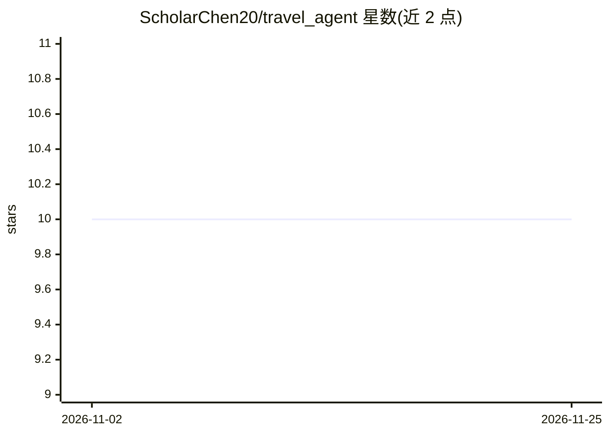

# ScholarChen20/travel_agent

⭐ 10 · Python · 推送 2026-04-14 · [GitHub](https://github.com/ScholarChen20/travel_agent) · [官网](https://github.com/ScholarChen20/travel_agent) · 个人维护 · 中文 README

**基于 LLM 的旅行计划生成应用：对话式规划行程**

前后端分离的旅行规划 Web 应用：后端 FastAPI + HelloAgents 智能体框架，前端 Vue3/TypeScript，通过自然语言多轮对话生成个性化旅行计划，集成高德地图 MCP（POI 搜索、路线规划）、天气查询、景点/餐厅/酒店推荐。部署依赖 MySQL、MongoDB、Redis 三个数据库服务，需配置 DashScope/DeepSeek、高德、飞书、OSS 等多个 API 密钥；提供 Docker Compose 一键部署与手动开发部署两条路径，另含 ngrok 内网穿透与数据库备份脚本。面向旅行用户及学习 AI 应用开发的开发者。

## 筛选速览

| 维度 | 判定 | 备注 |
|---|---|---|
| AI 角色 | `ai-native` | 本体是模型或模型工具 |
| 许可风险 | `none` | — |
| 部署形态 | `self-host` | docker 或自建部署 |
| 模型依赖 | — | README 未给出锁定关系 |
| 硬件要求 | — | 无带数字的原话,不猜 |
| 安装摩擦 | `low` | 无编译、无系统依赖或容器化 |
| 成熟度 | — | 结构信号不足 |

## 能力要点

- 基于 HelloAgents 框架的智能体生成个性化旅行计划
- 集成高德地图服务：POI 搜索、路线规划、天气查询
- 多轮对话交互调整旅行计划
- Docker Compose 一键部署，含 ngrok 内网穿透与定时备份脚本

## 适用场景

- 为出行自动生成包含景点、餐厅、酒店的行程计划
- 通过对话随时调整旅行路线安排
- 学习 AI 应用开发与前后端分离架构的完整项目结构

## 场景标签

`聊天机器人` · 领域:对话与助手

## 证据(README 行号)

> L13: **智能旅行助手**是一个基于AI大模型的旅行规划应用，通过自然语言交互，为用户自动生成详细的旅行计划。系统集成了高德地图、天气服务、景点推荐等多种功能，让旅行规划变得简单而智能。
> L19: - 🤖 **AI智能规划**：基于大语言模型，理解用户需求，自动生成个性化旅行计划
> L44: |**HelloAgents**|Latest|AI智能体框架，实现智能对话和规划|

## 星数曲线

2026-11-02 10 → 2026-11-25 10（+0）

---
*卡片 v1 · prompt 1.4 · 生成 2026-11-20 · 置信度 high · 依据 README sha `232855449f45` · [字段定义](../../DATASET.md)*
