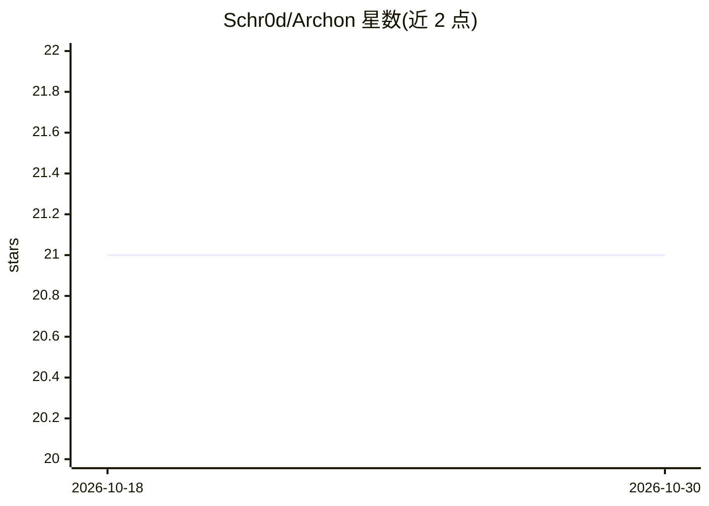

# Schr0d/Archon

⭐ 21 · Java · MIT · 推送 2026-04-20 · [GitHub](https://github.com/Schr0d/Archon) · 个人维护 · 中文 README

**供 AI 编码工具调用的本地依赖影响分析工具**

跨语言静态依赖分析 CLI：用真实解析器（Java 用 ArchUnit 字节码解析含 Spring DI，JS/TS 用 dependency-cruiser，Python 用 import 解析）构建依赖图，输出变更影响范围、领域分组、环与热点等指标，支持 diff 模式检测跨域依赖违规。设计为在 AI 编码工具的规划-执行-评审循环中被调用（如 Claude Code 的 /archon 命令），也面向人工重构前评估。本地运行，无云端依赖；需 Java 17。

## 筛选速览

| 维度 | 判定 | 备注 |
|---|---|---|
| AI 角色 | `ai-ecosystem` | LLM/agent 周边工具 |
| 许可风险 | `permissive` | MIT |
| 部署形态 | `None` |  |
| 模型依赖 | — | README 未给出锁定关系 |
| 硬件要求 | — | 无带数字的原话,不猜 |
| 安装摩擦 | `medium` | 含编译或系统依赖之一 |
| 成熟度 | — | 结构信号不足 |

## 能力要点

- 真实解析器构建依赖图：Java/ArchUnit（含 Spring DI）、JS/TS/dependency-cruiser、Python import 解析
- 输出 PageRank、betweenness、影响分、领域分组、环与热点等结构化 JSON
- diff 模式标记跨域依赖违规边，供 AI 提交前校验
- SPI 插件接口，可不改核心新增语言支持

## 适用场景

- 重构 Spring 服务前查看哪些文件依赖目标类
- 让 AI 编码助手在改动前获取架构上下文、提交前校验违规
- 大型代码库定位跨域依赖与循环依赖

## 场景标签

 · 领域:软件开发工具/静态分析

## 证据(README 行号)

> L26: Archon makes that knowledge visible before you change anything. It uses real parsers, not AI guessing: ArchUnit for
> L54: Archon is designed to be called by AI coding tools during the plan-execute-review loop.

## 星数曲线

2026-10-18 21 → 2026-10-30 21（+0）

---
*卡片 v1 · prompt 1.4 · 生成 2026-10-28 · 置信度 high · 依据 README sha `89966cd48584` · [字段定义](../../DATASET.md)*
