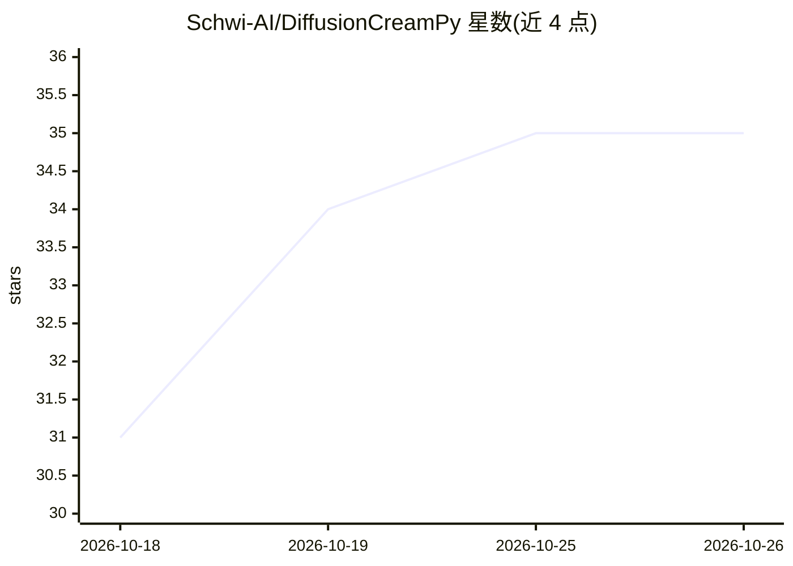

# Schwi-AI/DiffusionCreamPy

⭐ 35 · CC-BY-4.0 · 推送 2026-05-13 · [GitHub](https://github.com/Schwi-AI/DiffusionCreamPy) · 个人维护

**用 SDXL+ControlNet 去除 Hentai 马赛克/条形遮挡的 ComfyUI 工作流模板集**

受 DeepCreamPy 启发、基于 Stable Diffusion XL + ControlNet Union Promax 的去审查（decensoring）方案，以 3 个 ComfyUI 工作流模板交付：条形遮挡去除（需先用图像编辑软件将遮挡区域涂绿）、马赛克去除（用 ComfyUI 内置 MaskEditor 涂抹）和通用局部重绘。模型可替换，支持 prompt、seed、denoise、demosaic、mask 等参数调节。需自行搭建 ComfyUI（教程基于 0.16.3）并安装 4 个自定义节点，GPU 建议 12GB+ VRAM、32GB 内存。

## 筛选速览

| 维度 | 判定 | 备注 |
|---|---|---|
| AI 角色 | `ai-native` | 本体是模型或模型工具 |
| 许可风险 | `viral` | CC-BY-4.0 |
| 部署形态 | `None` |  |
| 模型依赖 | — | README 未给出锁定关系 |
| 硬件要求 | `gpu-8g` | |
| 安装摩擦 | `low` | 无编译、无系统依赖或容器化 |
| 成熟度 | — | 结构信号不足 |

## 能力要点

- 3 个 ComfyUI 工作流：条形去除、马赛克去除、局部重绘
- 基于 SDXL + ControlNet Union Promax，checkpoint 可替换
- 马赛克去除无需预处理原图，用内置 MaskEditor 涂抹即可
- 提供 denoise/demosaic/mask_grow/mask_blur 等参数调节说明

## 适用场景

- 去除同人图中的条形或马赛克遮挡
- 对去审查结果做局部细节重绘与润色
- 切换不同 SDXL 微调模型调整生成风格

## 场景标签

`图像生成` `图像视频处理` · 领域:内容生成

## 证据(README 行号)

> L11: - DiffusionCreamPy-Bar-CNet++ workflow removes bar censorship from a preprocessed image.
> L13: - DiffusionCreamPy-Mosaic-CNet++ workflow removes mosaic censorship from an image.
> L15: - DiffusionCreamPy-Inpaint-CNet++ workflow enables you to refine the decensored image or locally repaint specific d
> L241: - Stable Diffusion XL + ControlNet

## 星数曲线

2026-10-18 31 → 2026-10-26 35（+4）

---
*卡片 v1 · prompt 1.4 · 生成 2026-10-25 · 置信度 high · 依据 README sha `6de96c66b489` · [字段定义](../../DATASET.md)*
