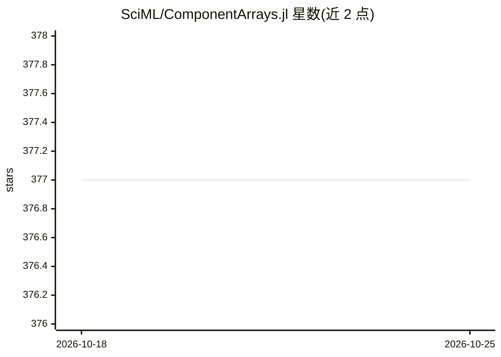

# SciML/ComponentArrays.jl

⭐ 377 · Julia · MIT · 推送 2026-10-19 · [GitHub](https://github.com/SciML/ComponentArrays.jl) · [官网](https://docs.sciml.ai/ComponentArrays/stable/) · 组织维护

**给 Julia 用户的嵌套命名分量数组库，用于模型组合与求解器**

Julia 包，核心导出 ComponentArray 类型：数组块可按命名索引访问，分量是原数组的视图。可在不引入建模语言的情况下实现独立模型的函数式组合，主要面向 DifferentialEquations.jl 与 Optim.jl 等需要平坦向量的场景。支持从 NamedTuple 风格构造一维 ComponentVector、由已有数组修改构造、广播运算自动生成带命名轴的二维 ComponentMatrix。README 提供微分方程组合示例，说明分量可各自作为 ODEProblem 单独单元测试。

## 筛选速览

| 维度 | 判定 | 备注 |
|---|---|---|
| AI 角色 | `ai-ecosystem` | LLM/agent 周边工具 |
| 许可风险 | `permissive` | MIT |
| 部署形态 | `None` |  |
| 模型依赖 | — | README 未给出锁定关系 |
| 硬件要求 | — | 无带数字的原话,不猜 |
| 安装摩擦 | `low` | 无编译、无系统依赖或容器化 |
| 成熟度 | — | 结构信号不足 |

## 能力要点

- 命名索引访问数组块，分量为原数组视图
- 通过函数组合拼接独立模型，无需建模语言
- 广播运算自动生成带命名轴的二维 ComponentMatrix
- 组合模型中各分量可单独作为 ODEProblem 运行与单元测试

## 适用场景

- 在 DifferentialEquations.jl 中组合多个子模型求解而无需手工管理索引
- 在 Optim.jl 等需要平坦向量的优化器中使用带命名的参数向量
- 将大模型拆分为可单独测试的组件

## 场景标签

 · 领域:科学计算/Julia 生态

## 证据(README 行号)

> L11: language for, but without actually needing a modeling language. The main targets are for use
> L12: in DifferentialEquations.jl and

## 星数曲线

2026-10-18 377 → 2026-10-25 377（+0）

---
*卡片 v1 · prompt 1.4 · 生成 2026-10-21 · 置信度 low · 依据 README sha `d28b6ca490ba` · [字段定义](../../DATASET.md)*
