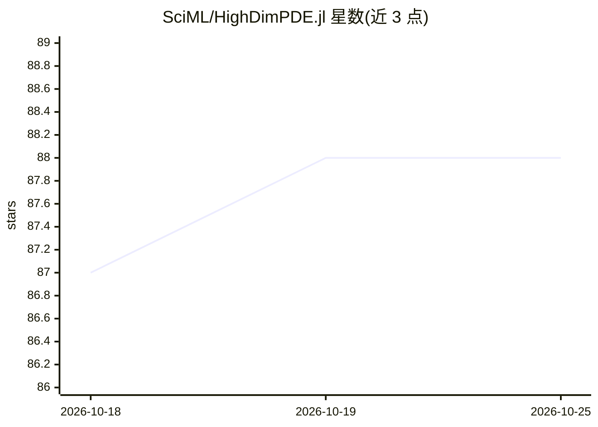

# SciML/HighDimPDE.jl

⭐ 88 · Julia · NOASSERTION · 推送 2026-10-19 · [GitHub](https://github.com/SciML/HighDimPDE.jl) · [官网](https://docs.sciml.ai/HighDimPDE/stable/) · 组织维护

**Julia 包：用深度学习（Deep BSDE/Feynman-Kac）解高维非线性 PDE**

SciML 组织维护的 Julia 科学计算包，面向高维非局部、非线性偏微分方程的数值求解，采用 Deep BSDE 与 Feynman-Kac 等深度学习方法，避免维度灾难。用户在 Julia 中通过 Pkg.add 安装，参考文档与 test 目录上手；适用对象为科学计算与科学机器学习方向的研究者和开发者。README 附有 Boussange 等人 2022 年 arXiv 论文作为方法参考。

## 筛选速览

| 维度 | 判定 | 备注 |
|---|---|---|
| AI 角色 | `ai-native` | 本体是模型或模型工具 |
| 许可风险 | `none` | NOASSERTION |
| 部署形态 | `None` |  |
| 模型依赖 | — | README 未给出锁定关系 |
| 硬件要求 | — | 无带数字的原话,不猜 |
| 安装摩擦 | `low` | 无编译、无系统依赖或容器化 |
| 成熟度 | — | 结构信号不足 |

## 能力要点

- 求解形式为非局部非线性积分-微分算子的高维 PDE
- 提供 Deep BSDE 与 Feynman-Kac 深度学习方法
- 通过 Julia Pkg 一键安装，自动下载依赖
- 附 arXiv 方法论文（Boussange et al. 2022）

## 适用场景

- 数值求解高维非线性 PDE（维度灾难场景）
- 科学机器学习研究中验证深度 PDE 求解方法
- 配合 Julia SciML 生态做偏微分方程建模

## 场景标签

`科研工具` · 领域:学习与行业

## 证据(README 行号)

> L12: **HighDimPDE.jl** is a Julia package to **solve Highly Dimensional non-local, non-linear PDEs** of the form
> L47:  - Boussange, V., Becker, S., Jentzen, A., Kuckuck, B., Pellissier, L., Deep learning approximations for non-local 

## 星数曲线

2026-10-18 87 → 2026-10-25 88（+1）

---
*卡片 v1 · prompt 1.4 · 生成 2026-10-23 · 置信度 mid · 依据 README sha `9a09badc3f94` · [字段定义](../../DATASET.md)*
