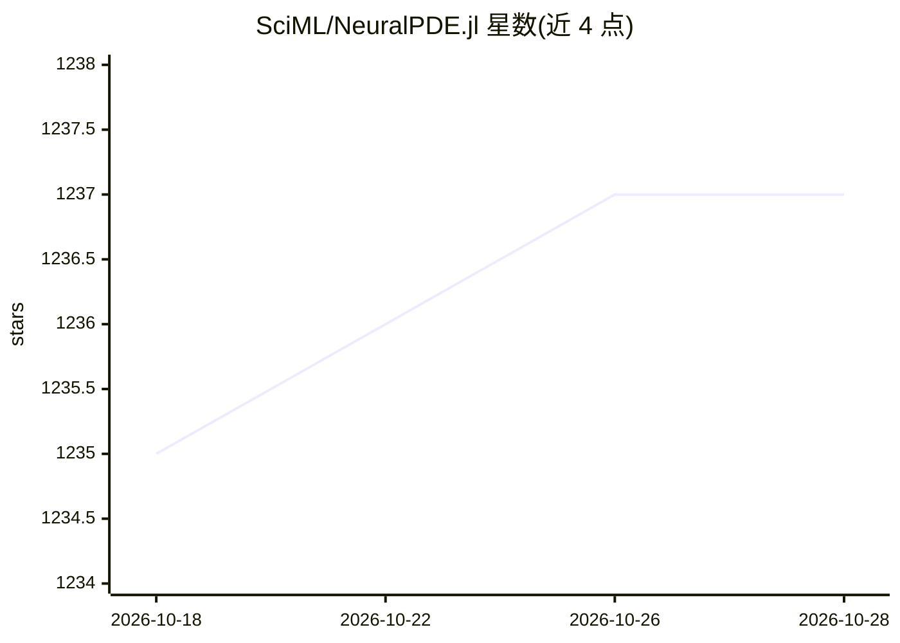

# SciML/NeuralPDE.jl

⭐ 1,237 · Julia · NOASSERTION · 推送 2026-10-17 · [GitHub](https://github.com/SciML/NeuralPDE.jl) · [官网](https://docs.sciml.ai/NeuralPDE/stable/) · 组织维护

**面向科研计算：用 PINN 求解微分方程的 Julia 求解器包**

SciML 生态下的 Julia 求解器包，基于物理信息神经网络（PINN）求解 ODE、SDE、RODE 与 PDE。提供从高级符号接口自动构建物理信息损失函数的能力，可将 PDE 离散化为 ModelingToolkit.System 并生成优化问题，支持加权/约束边界条件、积分与准随机训练策略、Reactant 编译训练循环。可定义额外损失函数将方程求解与数据拟合混合（科学机器学习），兼容 Flux.jl 与 Lux.jl 的 GPU 机器学习层，并可结合 NeuralOperators.jl 使用 DeepONet、Fourier 神经算子等。通过 Julia Pkg 以 `] add NeuralPDE` 安装，附论文引用信息。

## 筛选速览

| 维度 | 判定 | 备注 |
|---|---|---|
| AI 角色 | `ai-native` | 本体是模型或模型工具 |
| 许可风险 | `none` | NOASSERTION |
| 部署形态 | `None` |  |
| 模型依赖 | — | README 未给出锁定关系 |
| 硬件要求 | — | 无带数字的原话,不猜 |
| 安装摩擦 | `low` | 无编译、无系统依赖或容器化 |
| 成熟度 | — | 结构信号不足 |

## 能力要点

- 基于 PINN 求解 ODE/SDE/RODE/PDE
- 从符号接口自动构建物理信息损失函数
- PDE 离散化为 ModelingToolkit.System 并生成优化问题
- 兼容 Flux.jl/Lux.jl GPU 层与 NeuralOperators.jl 神经算子

## 适用场景

- 科研与工程中求解偏微分方程的替代数值方法
- 将物理方程求解与实验数据拟合结合的科学机器学习
- 结合神经算子做加速仿真研究

## 场景标签

`科研工具` · 领域:学习与行业

## 证据(README 行号)

> L13: NeuralPDE.jl is a solver package which consists of neural network solvers for
> L14: partial differential equations using physics-informed neural networks (PINNs). This package utilizes
> L32:  - Physics-Informed Neural Networks for ODE, SDE, RODE, and PDE solving

## 星数曲线

2026-10-18 1,235 → 2026-10-28 1,237（+2）

---
*卡片 v1 · prompt 1.4 · 生成 2026-10-21 · 置信度 high · 依据 README sha `78011a8553ea` · [字段定义](../../DATASET.md)*
