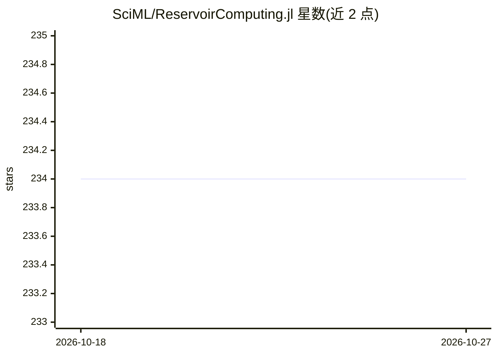

# SciML/ReservoirComputing.jl

⭐ 234 · Julia · MIT · 推送 2026-10-24 · [GitHub](https://github.com/SciML/ReservoirComputing.jl) · [官网](https://docs.sciml.ai/ReservoirComputing/stable/) · 组织维护

**Julia 储备计算库：构建与训练 ESN 等模型**

SciML 组织维护的 Julia 储备计算（Reservoir Computing）工具库，提供回声状态网络（ESN）及其十余种变体（DelayESN、DeepESN、HybridESN、ES2N 等）、液态状态机、Conceptors、NGRC、元胞自动机储备等完整模型，以及 20+ 储备层初始化器、多种读出与训练算法（Ridge/SVM/MLJLinearModels）。支持稀疏矩阵计算与连续时间储备（对接 SciMLProblem），面向科学机器学习场景的时间序列预测与动力系统学习。通过 Julia Pkg 安装，附 arXiv 论文可引用。

## 筛选速览

| 维度 | 判定 | 备注 |
|---|---|---|
| AI 角色 | `ai-native` | 本体是模型或模型工具 |
| 许可风险 | `permissive` | MIT |
| 部署形态 | `None` |  |
| 模型依赖 | — | README 未给出锁定关系 |
| 硬件要求 | — | 无带数字的原话,不猜 |
| 安装摩擦 | `low` | 无编译、无系统依赖或容器化 |
| 成熟度 | — | 结构信号不足 |

## 能力要点

- 十余种 ESN 变体与 LSM、Conceptor、NGRC、RECA 等完整模型
- 20+ 储备初始化器与多种训练算法（LIBSVM/MLJLinearModels/LinearSolve）
- 稀疏矩阵计算与 StateSpaceSet 输入输出支持
- 连续时间储备计算：SciMLProblemReservoir 与 ContinuousESN

## 适用场景

- 用 ESN 学习动力系统（如 Lorenz）的演化并做预测
- 时间序列预测与序列建模任务的储备计算建模
- 科研工作中作为可引用的储备计算实验工具

## 场景标签

`科研工具` · 领域:学习与行业

## 证据(README 行号)

> L14: ReservoirComputing.jl provides an efficient, modular and easy to use
> L25: ReservoirComputing.jl provides layers, models, and functions to help build and train
> L85: how it is possible to train an ESN to learn the dynamics of the

## 星数曲线

2026-10-18 234 → 2026-10-27 234（+0）

---
*卡片 v1 · prompt 1.4 · 生成 2026-10-22 · 置信度 high · 依据 README sha `9dd8a9b27295` · [字段定义](../../DATASET.md)*
