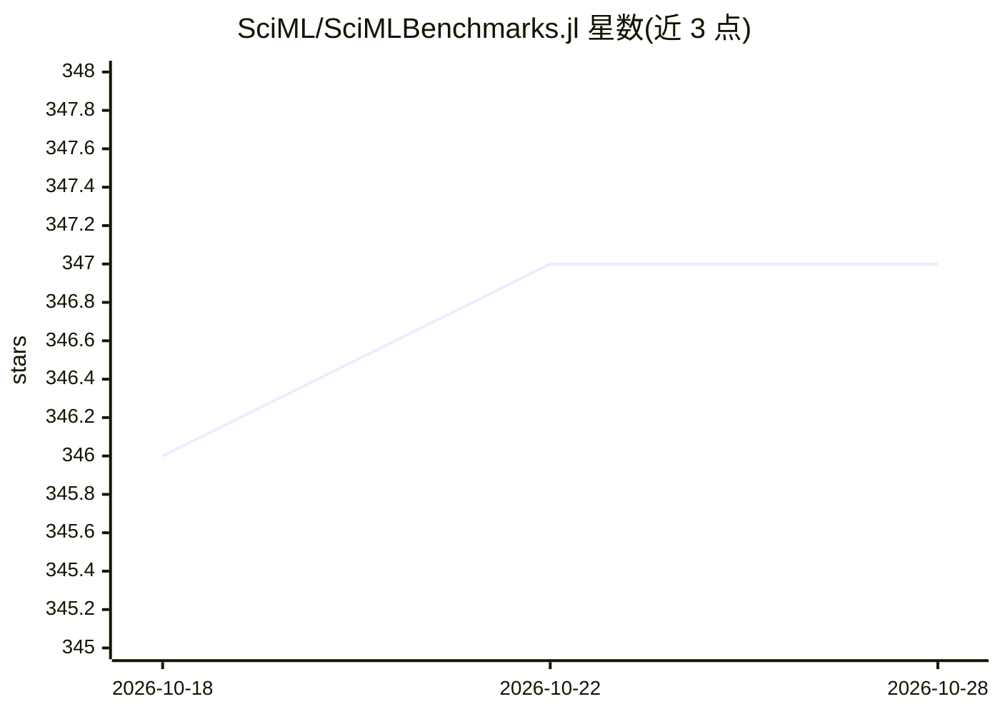

# SciML/SciMLBenchmarks.jl

⭐ 347 · Julia · MIT · 推送 2026-10-24 · [GitHub](https://github.com/SciML/SciMLBenchmarks.jl) · [官网](https://docs.sciml.ai/SciMLBenchmarksOutput/stable/) · 组织维护

**SciML 生态的科学机器学习与微分方程求解器基准集合**

SciMLBenchmarks.jl 收录科学机器学习软件生态的基准测试网页、PDF 与笔记本，覆盖方程求解器实现对比、参数估计/逆问题方法比较、通用微分方程（含神经 ODE）与 PINN 训练、代理模型（RBF、DeepONet、FNO 等）对比。每个基准记录所用计算设备与包版本，以 work-precision 效率衡量，跑在自托管 CI 运行器（AMD EPYC CPU、Tesla V100 GPU）。通过 Julia 安装包生成交互笔记本，结果发布于 docs.sciml.ai。README 附有当前基准结论摘要（如非刚性 ODE 各方法效率排序）。

## 筛选速览

| 维度 | 判定 | 备注 |
|---|---|---|
| AI 角色 | `ai-knowledge` | 知识聚合/清单类 |
| 许可风险 | `permissive` | MIT |
| 部署形态 | `None` |  |
| 模型依赖 | — | README 未给出锁定关系 |
| 硬件要求 | — | 无带数字的原话,不猜 |
| 安装摩擦 | `low` | 无编译、无系统依赖或容器化 |
| 成熟度 | — | 结构信号不足 |

## 能力要点

- 覆盖方程求解、参数估计、神经 ODE/PINN 训练、神经算子代理等基准
- 以 work-precision 效率（同误差下的耗时对比）为衡量方式
- 每个基准记录计算设备与包版本以支持复现
- 通过 SciMLBenchmarks.open_notebooks() 生成交互式笔记本

## 适用场景

- 为科学计算/SciML 项目选择微分方程求解器或参数估计方法
- 复现并验证各语言/库（Julia、Python、MATLAB、R）求解器的性能对比
- 贡献新的基准或改进现有基准代码

## 场景标签

`模型评测` · 领域:评测与运维

## 证据(README 行号)

> L11: SciMLBenchmarks.jl holds webpages, pdfs, and notebooks showing the benchmarks
> L14: - Benchmarks of equation solver implementations
> L20: The SciML Bench suite is made to be a comprehensive open source benchmark from the ground up, covering the methods 

## 星数曲线

2026-10-18 346 → 2026-10-28 347（+1）

---
*卡片 v1 · prompt 1.4 · 生成 2026-10-21 · 置信度 high · 依据 README sha `200842409be5` · [字段定义](../../DATASET.md)*
