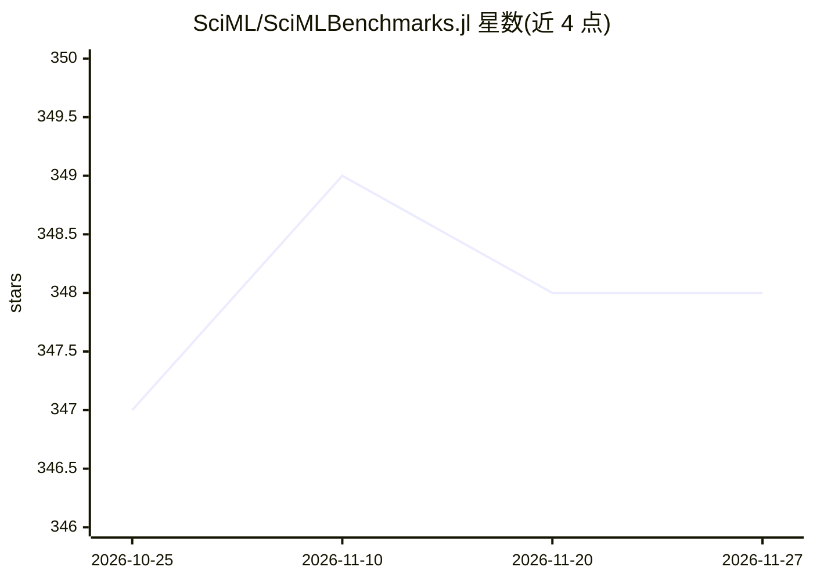

# SciML/SciMLBenchmarks.jl

⭐ 348 · Julia · MIT · 推送 2026-11-26 · [GitHub](https://github.com/SciML/SciMLBenchmarks.jl) · [官网](https://docs.sciml.ai/SciMLBenchmarksOutput/stable/) · 组织维护

**面向科研人员的 SciML 与方程求解器开源基准套件**

SciML 生态的基准仓库，收录方程求解器实现、参数估计/反问题方法、通用微分方程与神经网络 ODE 训练、PINN、代理模型（DeepONet、FNO 等）对比，覆盖 Julia、Python（PyTorch、JAX）、MATLAB、R 多语言实现。基准强调可复现：记录计算设备与包版本，以 work-precision 图度量效率；结果以 PDF/markdown/HTML 发布于 docs.sciml.ai，并可本地生成交互式 notebook；通过自托管 GitHub Actions runner 运行（含 CPU 与 V100 GPU 节点）。

## 筛选速览

| 维度 | 判定 | 备注 |
|---|---|---|
| AI 角色 | `ai-knowledge` | 知识聚合/清单类 |
| 许可风险 | `permissive` | MIT |
| 部署形态 | `None` |  |
| 模型依赖 | — | README 未给出锁定关系 |
| 硬件要求 | — | 无带数字的原话,不猜 |
| 安装摩擦 | `low` | 无编译、无系统依赖或容器化 |
| 成熟度 | — | 结构信号不足 |

## 能力要点

- 覆盖非刚性/刚性 ODE、SDE、DDE、参数估计等多类基准并在 README 汇总结论
- 多语言覆盖：Julia、Python（PyTorch、JAX）、MATLAB、R
- 记录计算设备与包版本以保证可复现，支持 PR 方式提交基准修改
- 可本地生成交互式 notebook（SciMLBenchmarks.open_notebooks()）

## 适用场景

- 为微分方程求解任务挑选求解器前查阅各方法效率对比
- 为 SciML/Neural ODE/PINN 研究寻找可复现的基准配置
- 以 PR 形式贡献新方法代码到现有基准

## 场景标签

`模型评测` · 领域:评测与运维

## 证据(README 行号)

> L11: SciMLBenchmarks.jl holds webpages, pdfs, and notebooks showing the benchmarks
> L14: - Benchmarks of equation solver implementations
> L20: The SciML Bench suite is made to be a comprehensive open source benchmark from the ground up, covering the methods 

## 星数曲线

2026-10-25 347 → 2026-11-27 348（+1）

---
*卡片 v1 · prompt 1.4 · 生成 2026-11-27 · 置信度 high · 依据 README sha `68d114abdbc5` · [字段定义](../../DATASET.md)*
