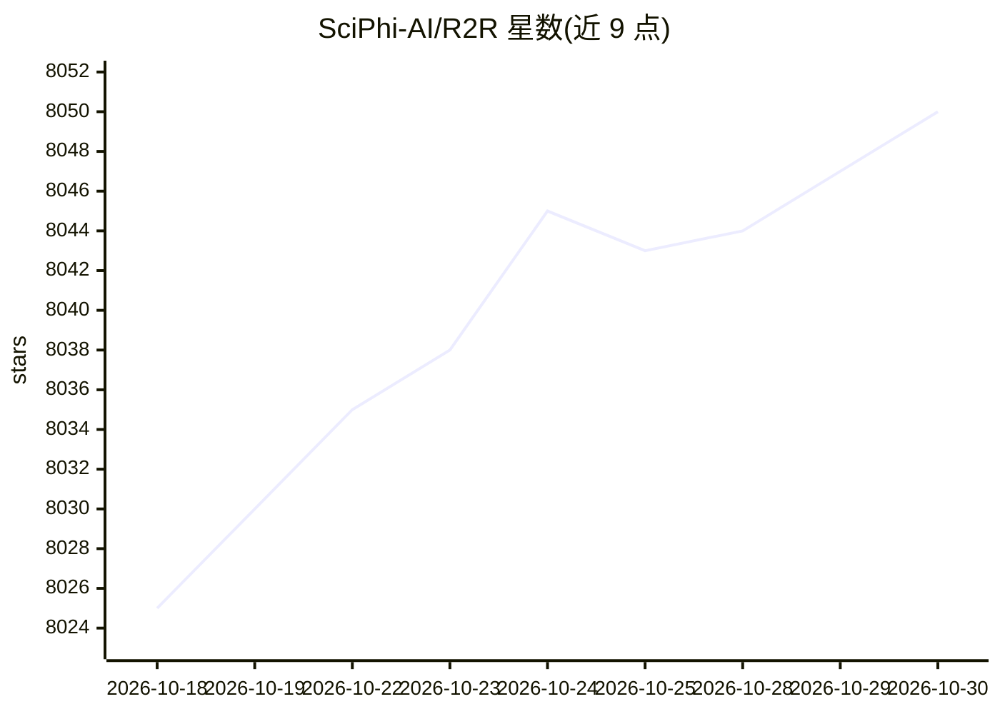

# SciPhi-AI/R2R

⭐ 8,050 · Python · MIT · 推送 2025-11-07 · [GitHub](https://github.com/SciPhi-AI/R2R) · 组织维护

**面向生产的 Agentic RAG 检索系统，RESTful API 交付**

R2R 是一个支持检索增强生成（RAG）的 AI 检索系统，以 RESTful API 形式提供。功能包括多模态内容摄取（txt/pdf/json/png/mp3 等）、语义+关键词混合搜索（倒数排名融合）、自动实体与关系抽取的知识图谱、与检索集成的推理 agent、文档管理及用户与访问管理；另含 Deep Research API，可从知识库和/或互联网多步检索以回答复杂查询。提供 Python 与 JavaScript SDK，pip 安装后配合 OpenAI API key 即可运行，也支持自托管。

## 筛选速览

| 维度 | 判定 | 备注 |
|---|---|---|
| AI 角色 | `ai-ecosystem` | LLM/agent 周边工具 |
| 许可风险 | `permissive` | MIT |
| 部署形态 | `library` | 以包/库形式分发 |
| 模型依赖 | — | README 未给出锁定关系 |
| 硬件要求 | — | 无带数字的原话,不猜 |
| 安装摩擦 | `low` | 无编译、无系统依赖或容器化 |
| 成熟度 | — | 结构信号不足 |

## 能力要点

- 多模态摄取：txt/pdf/json/png/mp3 等格式
- 语义+关键词混合搜索（reciprocal rank fusion）
- 知识图谱：自动实体与关系抽取
- Deep Research API：多步推理，可检索知识库与互联网

## 适用场景

- 搭建带认证与文档管理的自托管 RAG 问答服务
- 对私有文档库做混合搜索与知识图谱构建
- 通过 RESTful API/SDK 将检索与 Agentic RAG 集成到应用

## 场景标签

`RAG` `知识图谱` `语义搜索` · 领域:知识与检索

## 证据(README 行号)

> L19: R2R is an advanced AI retrieval system supporting Retrieval-Augmented Generation (RAG) with production-ready featur
> L21: R2R also includes a **Deep Research API**, a multi-step reasoning system that fetches relevant data from your knowl

## 星数曲线

2026-10-18 8,025 → 2026-10-30 8,050（+25）

---
*卡片 v1 · prompt 1.4 · 生成 2026-10-20 · 置信度 high · 依据 README sha `fe0dc9873428` · [字段定义](../../DATASET.md)*
