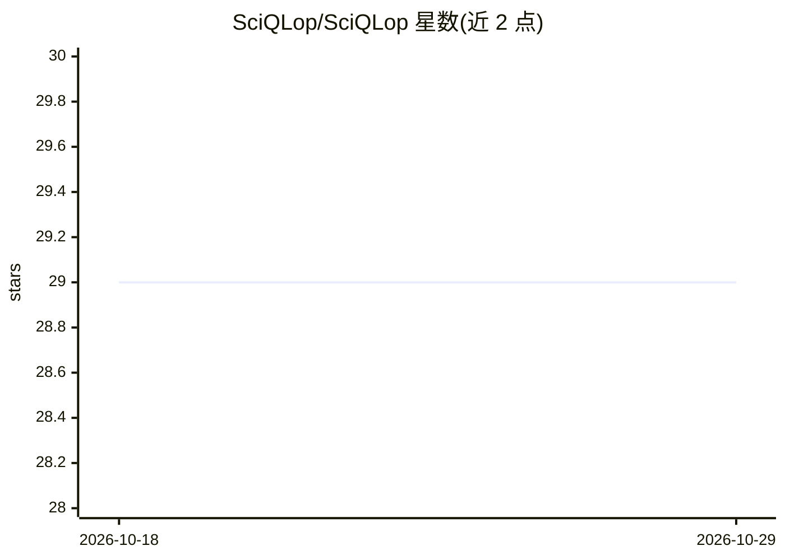

# SciQLop/SciQLop

⭐ 29 · Python · GPL-3.0 · 推送 2026-10-21 · [GitHub](https://github.com/SciQLop/SciQLop) · [官网](https://sciqlop.github.io/) · 组织维护

**给空间物理研究者的原位等离子体卫星数据浏览、标注与分析 IDE**

基于 PySide6/Qt6 的桌面应用，面向空间物理科研与教学：通过 AMDA、NASA CDAWeb、ESA CSA 等档案访问 MMS、THEMIS、Cluster、Solar Orbiter 等任务的上万种数据产品，支持交互式多变量时序绘图、图形化事件标注与目录（catalog）编辑、基于 CRDT/WebSocket 的多人实时协作编目，并内嵌 IPython 内核与 JupyterLab 集成（%plot、%%vp 等 magics）。提供插件 App Store、workspace 隔离 Python 环境（uv 管理）、命令面板。AI 助手为可插拔后端的聊天 dock（Claude Code、GitHub Copilot 等），可绘图、取数、运行 notebook 单元，属于附加功能。桌面端提供 Windows/macOS/Linux 安装包，开发者的源码运行方式为 uv run。

## 筛选速览

| 维度 | 判定 | 备注 |
|---|---|---|
| AI 角色 | `ai-enhanced` | 去掉 AI 部分产品仍成立 |
| 许可风险 | `viral` | GPL-3.0 |
| 部署形态 | `desktop` | 安装包/桌面程序 |
| 模型依赖 | — | README 未给出锁定关系 |
| 硬件要求 | — | 无带数字的原话,不猜 |
| 安装摩擦 | `low` | 无编译、无系统依赖或容器化 |
| 成熟度 | — | 结构信号不足 |

## 能力要点

- 经 AMDA/CDAWeb/CSA/SSCWeb 访问 MMS、Cluster、Solar Orbiter 等多任务数据产品
- 图形化事件标注与目录系统，支持 cocat CRDT 多人实时协作编辑
- 内嵌 IPython 内核与 JupyterLab 集成，提供 %plot/%%vp 等 magics
- 可插拔 AI 后端的助手聊天 dock，可绘图、取数、运行 notebook 单元

## 适用场景

- 浏览和绘制多任务卫星的原位等离子体时序测量数据
- 为感兴趣的空间物理事件建立并协作编辑目录/事件编目
- 在 Jupyter notebook 中对同一数据进行脚本化分析与统计
- 用于空间物理与航天器数据处理的教学（内置引导教程）

## 场景标签

`科研工具` `教程课程` `数据分析` · 领域:效率与自动化

## 证据(README 行号)

> L14: user-friendly tool designed for the visualization and analysis of in-situ space plasma data: browse, plot, label,
> L108: SciQLop ships an agent chat dock with pluggable AI backends — Claude Code, GitHub Copilot, OpenCode, and

## 星数曲线

2026-10-18 29 → 2026-10-29 29（+0）

---
*卡片 v1 · prompt 1.4 · 生成 2026-10-26 · 置信度 mid · 依据 README sha `3f2462e70134` · [字段定义](../../DATASET.md)*
