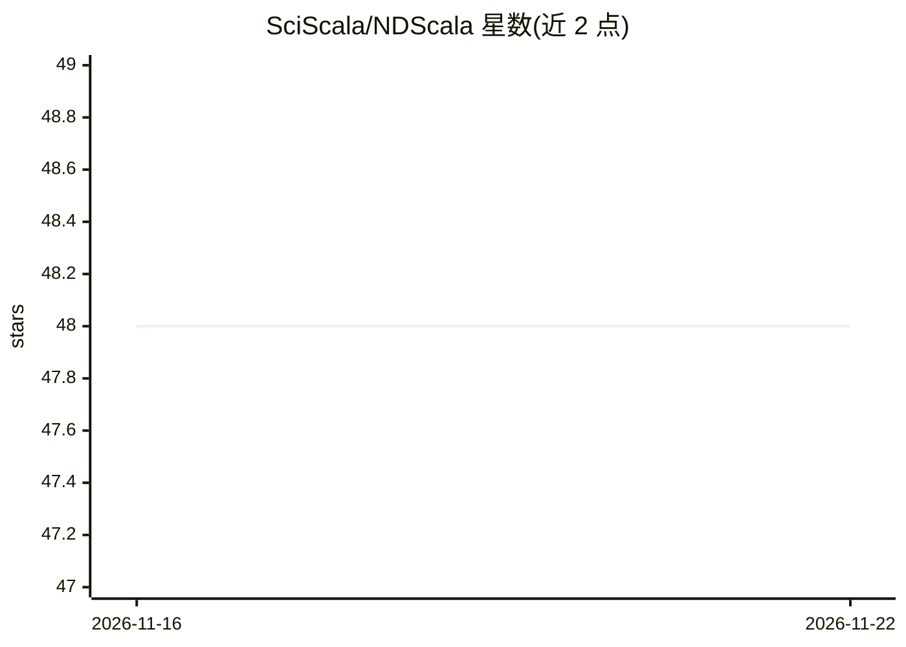

# SciScala/NDScala

⭐ 48 · Scala · AGPL-3.0 · 推送 2026-11-15 · [GitHub](https://github.com/SciScala/NDScala) · 组织维护

**Scala 3 的形状/类型安全 N 维数组（张量）库**

NDScala 是 Scala 3 下的 N 维/多维数组（张量）库，定位类似 NumPy ndarray / PyTorch Tensor，但在形状、数组/轴标签与数值数据类型上提供编译期类型安全。README 以约 10 行代码演示用其训练一个形状安全的神经网络，并与 NumPy（MKL）、PyTorch 的等价实现做运行时间参照：NDScala 版本约为 NumPy w/MKL 的 80%，PyTorch 约比 NDScala 快 15%，差异归因于 JVM 与本地内存间传数据的拷贝开销。面向 Scala/JVM 生态下做数值计算与机器学习的开发者。

## 筛选速览

| 维度 | 判定 | 备注 |
|---|---|---|
| AI 角色 | `ai-ecosystem` | LLM/agent 周边工具 |
| 许可风险 | `viral` | AGPL-3.0 |
| 部署形态 | `None` |  |
| 模型依赖 | — | README 未给出锁定关系 |
| 硬件要求 | — | 无带数字的原话,不猜 |
| 安装摩擦 | `low` | 无编译、无系统依赖或容器化 |
| 成熟度 | — | 结构信号不足 |

## 能力要点

- 形状、轴标签与数值类型的编译期类型安全张量
- 提供神经网络训练示例（10 行代码）
- 与 NumPy/PyTorch 等价实现的运行时间对照数据

## 适用场景

- 在 Scala 3 中做需要形状安全的矩阵/张量运算
- JVM 生态下构建数值计算或机器学习管线
- 对比 NumPy/PyTorch 评估跨语言数值计算性能

## 场景标签

 · 领域:数值计算/机器学习基础库

## 证据(README 行号)

> L1: Training a (shape-safe) neural network in 10 lines:
> L20: The run time of the NDScala version is ~80% of that of NumPy w/MKL
> L23: This can be accounted for by the copy overhead of passing data between the JVM and native memory.

## 星数曲线

2026-11-16 48 → 2026-11-22 48（+0）

---
*卡片 v1 · prompt 1.4 · 生成 2026-11-18 · 置信度 mid · 依据 README sha `7dc8db780d14` · [字段定义](../../DATASET.md)*
