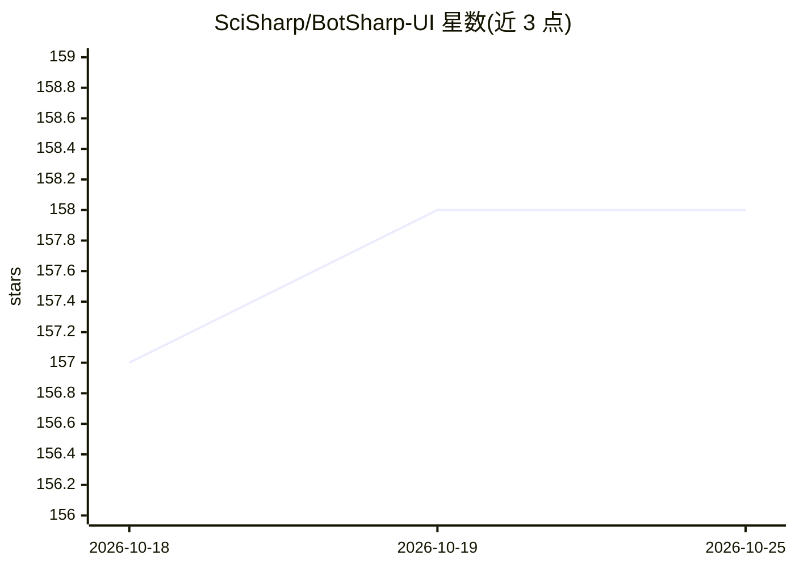

# SciSharp/BotSharp-UI

⭐ 158 · Svelte · Apache-2.0 · 推送 2026-09-29 · [GitHub](https://github.com/SciSharp/BotSharp-UI) · 组织维护 · 中文 README

**BotSharp 的 Agent 管理与对话 Web 前端**

基于 SvelteKit v2 的 Web 应用，用于创建与管理 AI Agent 及会话，后端依赖 BotSharp 提供 LLM 服务；提供节点式的 Agent 搭建体验。同一 UI 以 Tauri 桌面应用形式发布（Windows WebView2 / macOS WKWebView），桌面构建需安装 Rust 与 Visual Studio C++ 工作负载。部署目标为 Azure Static Web App，提供 build:verified 构建流程以校验凭据不出现在分发产物中。

## 筛选速览

| 维度 | 判定 | 备注 |
|---|---|---|
| AI 角色 | `ai-ecosystem` | LLM/agent 周边工具 |
| 许可风险 | `permissive` | Apache-2.0 |
| 部署形态 | `library` | 以包/库形式分发 |
| 模型依赖 | — | README 未给出锁定关系 |
| 硬件要求 | — | 无带数字的原话,不猜 |
| 安装摩擦 | `low` | 无编译、无系统依赖或容器化 |
| 成熟度 | — | 结构信号不足 |

## 能力要点

- 节点式 Agent 构建体验，管理与创建 Agent 及会话
- 同一 UI 提供 Tauri 桌面应用（系统 WebView，无原生命令桥接）
- build:verified 构建流程校验凭据不进入分发 bundle

## 适用场景

- 为 BotSharp 后端搭建可视化的 Agent 管理界面
- 在浏览器或桌面端测试和管理 AI 助手会话
- 通过品牌环境变量定制自己的分发版本

## 场景标签

`聊天机器人` · 领域:对话与助手

## 证据(README 行号)

> L3: The `BotSharp UI` is a web app used to manage agents and conversations. Through it you can build new Agent, manage e
> L4: This project is written in SvelteKit v2 and backed by BotSharp as the LLM services.

## 星数曲线

2026-10-18 157 → 2026-10-25 158（+1）

---
*卡片 v1 · prompt 1.4 · 生成 2026-10-22 · 置信度 high · 依据 README sha `524f3e99ba26` · [字段定义](../../DATASET.md)*
