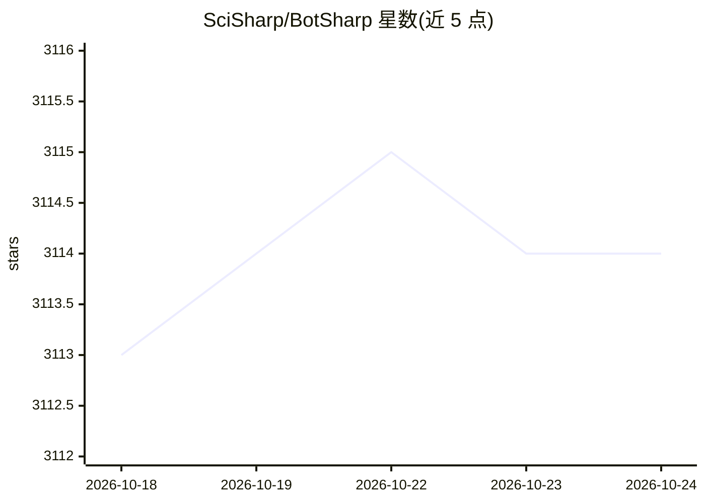

# SciSharp/BotSharp

⭐ 3,115 · C# · Apache-2.0 · 推送 2026-10-23 · [GitHub](https://github.com/SciSharp/BotSharp) · [官网](https://botsharp.readthedocs.io) · 组织维护 · 中文 README

**.NET 多智能体 AI 应用开发框架，面向企业业务系统集成**

BotSharp 是基于 C#/.NET Core 的开源 AI Agent 应用框架，提供多智能体、会话状态管理、多种 LLM 规划方式、RAG 接口与内置向量检索，通过插件与管道流设计解耦各组件。支持 ChatGPT、Gemini、Claude、DeepSeek、HuggingFace 等多家模型平台，接入 Facebook Messenger、Slack、Telegram、微信等消息渠道，并内置 MCP 集成与 SvelteKit 管理界面。面向使用 .NET 的企业开发者，需 .NET 6+ SDK，从源码运行后端与 UI 两个部分。

## 筛选速览

| 维度 | 判定 | 备注 |
|---|---|---|
| AI 角色 | `ai-ecosystem` | LLM/agent 周边工具 |
| 许可风险 | `permissive` | Apache-2.0 |
| 部署形态 | `library` | 以包/库形式分发 |
| 模型依赖 | locked-api |  |
| 硬件要求 | — | 无带数字的原话,不猜 |
| 安装摩擦 | `medium` | 含编译或系统依赖之一 |
| 成熟度 | — | 结构信号不足 |

## 能力要点

- 多智能体协作与路由/规划系统，会话状态管理
- 内置 RAG 接口与基于 Memory 的向量检索
- 模块化插件体系：LLM、存储、消息渠道、工具（SQL/WebDriver/Excel 等）
- 内置 MCP 集成，支持可视化管理和工具调用

## 适用场景

- 用 .NET 技术栈构建多智能体业务应用
- 将 LLM 接入现有企业信息系统与消息渠道
- 一站式构建、测试、评估与审计 LLM Agent

## 场景标签

`多智能体` `RAG` `Agent 框架` · 领域:Agent 开发

## 证据(README 行号)

> L13: **BotSharp** is an open source machine learning framework for AI Bot platform builder. This project involves natura
> L17: **BotSharp** is in accordance with components principle strictly, decouples every part that is needed in the platfo
> L26: * Build, test, evaluate and audit your LLM agent in one place.

## 星数曲线

2026-10-18 3,113 → 2026-10-24 3,114（+1）

---
*卡片 v1 · prompt 1.4 · 生成 2026-10-20 · 置信度 mid · 依据 README sha `118f3176860c` · [字段定义](../../DATASET.md)*
