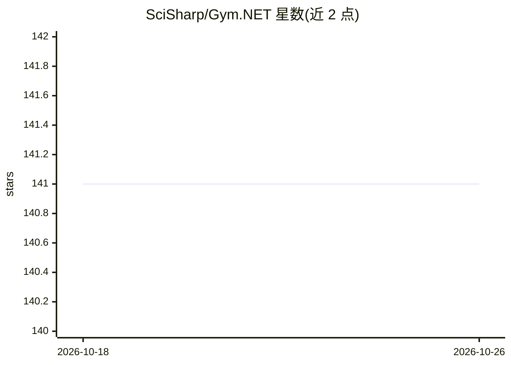

# SciSharp/Gym.NET

⭐ 141 · C# · Apache-2.0 · 推送 2026-09-27 · [GitHub](https://github.com/SciSharp/Gym.NET) · 组织维护

**OpenAI Gym 的 C# 移植版：强化学习算法开发与对比工具包**

将 openai/gym 工具包移植到 C#/.NET，为强化学习算法的开发与比较提供一套标准化环境集合。通过 NuGet 安装 Gym.NET 可获得 RL 抽象类与环境接口，示例演示运行并渲染 cartpole-v1 环境。代码依赖 NumSharp、SixLabors.ImageSharp 等 .NET 库。面向希望在 .NET 生态中开展强化学习实验的开发者。

## 筛选速览

| 维度 | 判定 | 备注 |
|---|---|---|
| AI 角色 | `ai-native` | 本体是模型或模型工具 |
| 许可风险 | `permissive` | Apache-2.0 |
| 部署形态 | `None` |  |
| 模型依赖 | — | README 未给出锁定关系 |
| 硬件要求 | — | 无带数字的原话,不猜 |
| 安装摩擦 | `low` | 无编译、无系统依赖或容器化 |
| 成熟度 | — | 结构信号不足 |

## 能力要点

- openai/gym 的 C# 移植
- 提供标准化强化学习环境集合
- 通过 NuGet 分发，含抽象类与环境接口
- 附 cartpole-v1 运行渲染示例

## 适用场景

- 在 .NET 项目中开发强化学习算法
- 使用标准化环境对比不同 RL 算法表现
- 在 C# 中运行 cartpole 等经典环境实验

## 场景标签

`强化学习` · 领域:训练与推理

## 证据(README 行号)

> L5: A port of openai/gym to C#.
> L8: OpenAI Gym is a toolkit for developing and comparing reinforcement learning algorithms. This is the gym open-source 

## 星数曲线

2026-10-18 141 → 2026-10-26 141（+0）

---
*卡片 v1 · prompt 1.4 · 生成 2026-10-22 · 置信度 high · 依据 README sha `34db853be468` · [字段定义](../../DATASET.md)*
