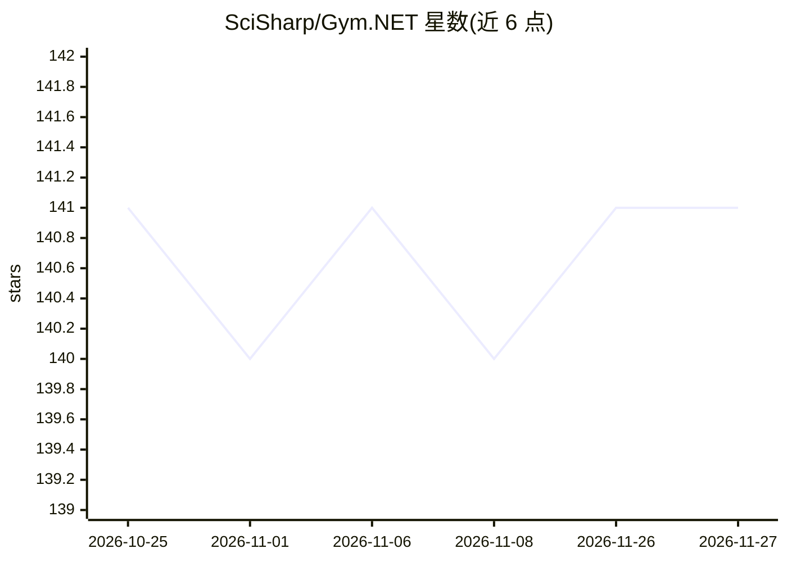

# SciSharp/Gym.NET

⭐ 141 · C# · Apache-2.0 · 推送 2026-11-25 · [GitHub](https://github.com/SciSharp/Gym.NET) · [官网](https://scisharp.github.io/Gym.NET/) · 组织维护

**.NET 平台的强化学习环境库：C# 移植 Gymnasium 39 个环境**

纯 C# 实现的 .NET 强化学习环境库，移植 Gymnasium 1.4.0 的 API 与 39 个环境 id，覆盖 classic_control、box2d、toy_text 与 MuJoCo，其中 Box2D 2.3.0 与 MuJoCo 引擎均以托管 C# 编写，无需安装原生代码或 CPython。以 NuGet 包分发，面向 .NET 8/10/11；提供 Env 契约、十个空间、包装器、向量环境与 EnvChecker 等检查器，并附带 24 个环境的示例工程。以 Gymnasium 为对照基准，声称同 seed 同动作下数值与渲染帧一致。

## 筛选速览

| 维度 | 判定 | 备注 |
|---|---|---|
| AI 角色 | `ai-ecosystem` | LLM/agent 周边工具 |
| 许可风险 | `permissive` | Apache-2.0 |
| 部署形态 | `None` |  |
| 模型依赖 | — | README 未给出锁定关系 |
| 硬件要求 | — | 无带数字的原话,不猜 |
| 安装摩擦 | `medium` | 含编译或系统依赖之一 |
| 成熟度 | — | 结构信号不足 |

## 能力要点

- 39 个 Gymnasium 环境 id 在纯托管 C# 中运行（Box2D 与 MuJoCo 引擎均为 C# 实现）
- 同 seed 同动作下与 Gymnasium 数值逐位一致，由进程内运行 Gymnasium 的 parity 测试套件校验
- 提供 SyncVectorEnv/AsyncVectorEnv（工作线程步进）及除 Atari/JAX/PyTorch 转换外的全部包装器
- NuGet 分发，Avalonia 或 WinForm 提供人类渲染窗口与键盘操作

## 适用场景

- 在 C#/.NET 中训练和评估强化学习 agent
- 把 Python Gymnasium 实验迁移到 .NET 并核对结果一致
- 用 Gymnasium 的契约编写和注册自定义环境

## 场景标签

`强化学习` · 领域:训练与推理

## 证据(README 行号)

> L11:  Gym.NET is a native .NET library for reinforcement learning: Gymnasium's environments and API, the same results fo
> L21: environment ids and the same numbers, with vector environments that step on worker threads instead of processes. It
> L25: The compatibility target is **Gymnasium v1.4.0**. Given the same seed and actions, Gym.NET returns the same observa

## 星数曲线

2026-10-25 141 → 2026-11-27 141（+0）

---
*卡片 v1 · prompt 1.4 · 生成 2026-11-27 · 置信度 high · 依据 README sha `f8bf71411b1c` · [字段定义](../../DATASET.md)*
