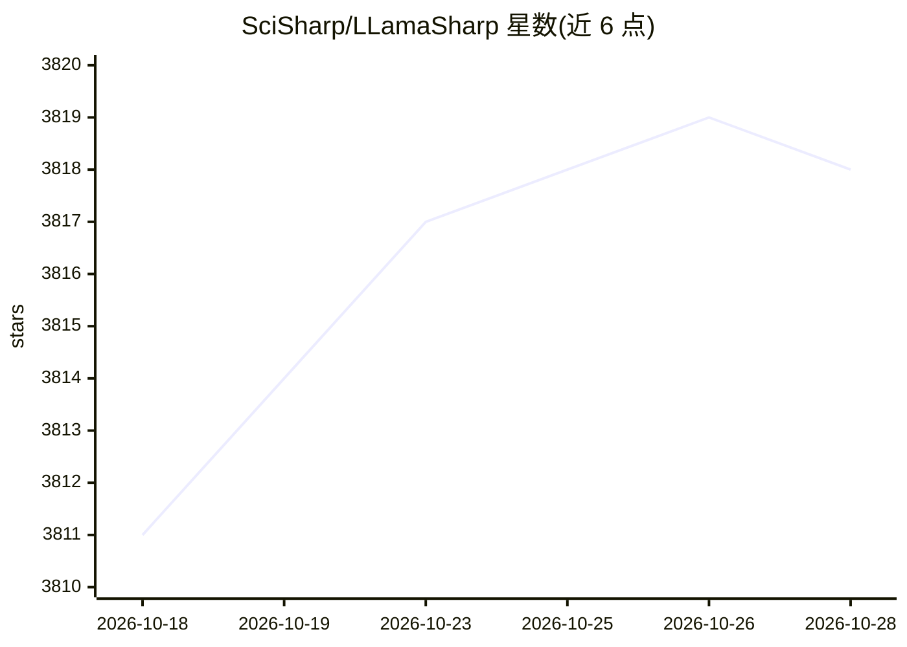

# SciSharp/LLamaSharp

⭐ 3,819 · C# · MIT · 推送 2026-10-26 · [GitHub](https://github.com/SciSharp/LLamaSharp) · [官网](https://scisharp.github.io/LLamaSharp) · 组织维护 · 中文 README

**C#/.NET 本地运行 LLM 的推理库，基于 llama.cpp**

面向 .NET 开发者的跨平台 LLM 推理库：封装 llama.cpp 的 C++ 原生库为 NuGet 后端包（CPU/CUDA 11-13/Metal/Vulkan），无需自行编译 C++，在 CPU 与 GPU 上运行 GGUF 格式模型（LLaMA、LLaVA 等），提供高层 API 与 RAG 支持。模型需从 Hugging Face 下载或由 PyTorch/Hugging Face 格式转换，推荐量化版本以降低内存占用。附带 BotSharp、LangChain 等集成与 Unity、Blazor、ASP.NET 等示例，MIT 许可。

## 筛选速览

| 维度 | 判定 | 备注 |
|---|---|---|
| AI 角色 | `ai-ecosystem` | LLM/agent 周边工具 |
| 许可风险 | `permissive` | MIT |
| 部署形态 | `None` |  |
| 模型依赖 | local-ok | 支持本地模型 |
| 硬件要求 | — | 无带数字的原话,不猜 |
| 安装摩擦 | `medium` | 含编译或系统依赖之一 |
| 成熟度 | — | 结构信号不足 |

## 能力要点

- 基于 llama.cpp 的 NuGet 后端包（CPU/CUDA 11-13/Metal/Vulkan），无需编译 C++
- 支持 GGUF 格式模型加载、对话会话与多模态（LLaVA）
- 提供高层 API 与 RAG 支持，便于在应用中部署 LLM
- 提供 Unity/Blazor/WPF/ASP.NET 等示例与 BotSharp、LangChain 集成

## 适用场景

- 在 .NET 应用中本地运行 LLaMA 等 LLM 做对话或推理
- 构建本地 RAG 或多模态（LLaVA）应用
- 在 Unity 或 ASP.NET 项目中集成本地模型能力

## 场景标签

`推理引擎` `RAG` `多模态` · 领域:知识与检索

## 证据(README 行号)

> L11: **LLamaSharp is a cross-platform library to run 🦙LLaMA model (and others) on your local device. Based on llama.cpp,
> L67: To gain high performance, LLamaSharp interacts with native libraries compiled from c++, these are called `backends`

## 星数曲线

2026-10-18 3,811 → 2026-10-28 3,818（+7）

---
*卡片 v1 · prompt 1.4 · 生成 2026-10-20 · 置信度 high · 依据 README sha `0dfea1a20a45` · [字段定义](../../DATASET.md)*
