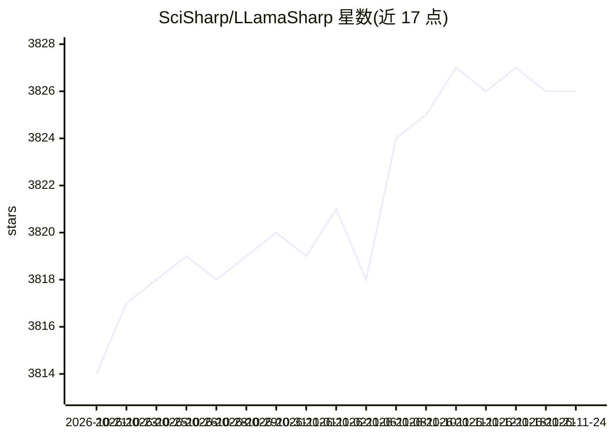

# SciSharp/LLamaSharp

⭐ 3,825 · C# · MIT · 推送 2026-11-20 · [GitHub](https://github.com/SciSharp/LLamaSharp) · [官网](https://scisharp.github.io/LLamaSharp) · 组织维护 · 中文 README

**在本地设备运行 LLaMA 等模型的 C#/.NET 库**

基于 llama.cpp 的跨平台 .NET 库，通过高级 API 在本地 CPU 与 GPU 上执行 LLM 推理。提供 NuGet 包与预编译 backend 包（CPU/CUDA/Metal/Vulkan），无需用户自行编译 C++；模型使用 GGUF 格式文件，可从 Huggingface 搜索或用 llama.cpp 脚本转换。支持聊天会话、多模态（LLaVA）与 RAG，另有 BotSharp、Langchain、MaIN.NET 集成及 Unity、WPF、Blazor、ASP.NET 等示例。MIT 许可，社区含 Discord 与 QQ 群。

## 筛选速览

| 维度 | 判定 | 备注 |
|---|---|---|
| AI 角色 | `ai-ecosystem` | LLM/agent 周边工具 |
| 许可风险 | `permissive` | MIT |
| 部署形态 | `None` |  |
| 模型依赖 | local-ok | 支持本地模型 |
| 硬件要求 | — | 无带数字的原话,不猜 |
| 安装摩擦 | `medium` | 含编译或系统依赖之一 |
| 成熟度 | — | 结构信号不足 |

## 能力要点

- 基于 llama.cpp 的本地推理，提供 CPU、CUDA、Metal、Vulkan 预编译 backend 包
- 使用 GGUF 格式模型文件，可自行转换或从 Huggingface 获取
- 支持 LLaVA 多模态与 RAG，提供 BotSharp、Langchain、MaIN.NET 集成
- 提供 Unity、WPF、Blazor、ASP.NET 等多种示例项目

## 适用场景

- 在 .NET 应用中嵌入本地 LLM 聊天功能
- 在 Unity 或桌面应用中运行本地模型
- 在不编译 C++ 的前提下按硬件选择 CUDA/Vulkan/Metal 后端

## 场景标签

`推理引擎` `聊天机器人` `RAG` `多模态` · 领域:对话与助手

## 证据(README 行号)

> L11: **LLamaSharp is a cross-platform library to run 🦙LLaMA model (and others) on your local device. Based on llama.cpp,
> L67: To gain high performance, LLamaSharp interacts with native libraries compiled from c++, these are called `backends`

## 星数曲线

2026-10-21 3,814 → 2026-11-24 3,826（+12）

---
*卡片 v1 · prompt 1.4 · 生成 2026-11-23 · 置信度 high · 依据 README sha `6b8a79c8e745` · [字段定义](../../DATASET.md)*
