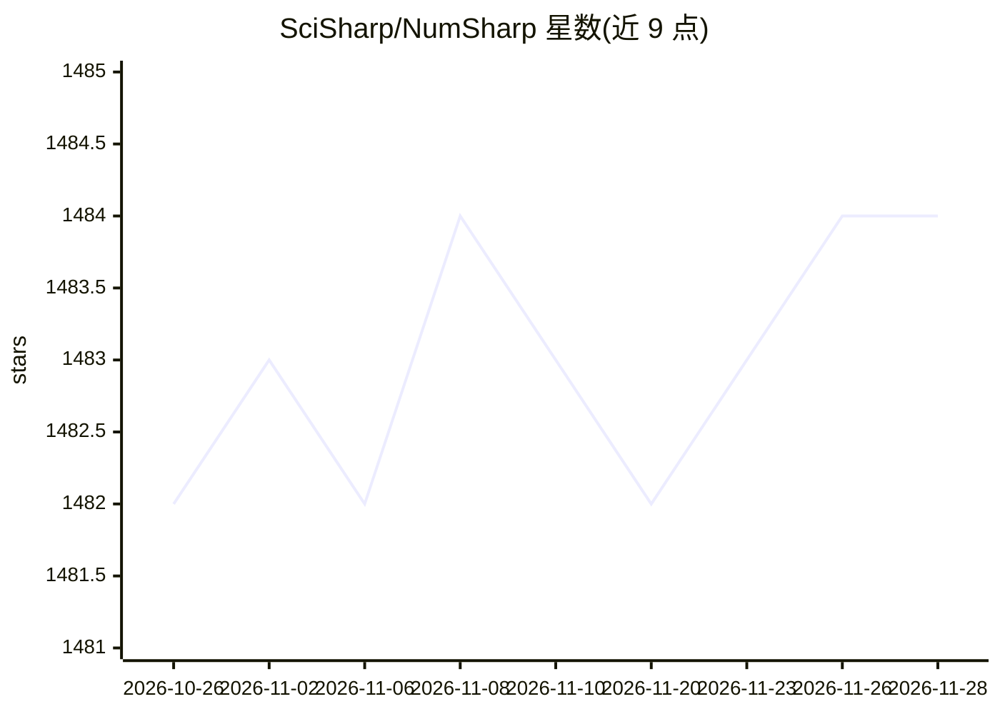

# SciSharp/NumSharp

⭐ 1,484 · C# · Apache-2.0 · 推送 2026-11-23 · [GitHub](https://github.com/SciSharp/NumSharp) · [官网](https://scisharp.github.io/NumSharp/) · 组织维护

**给 .NET 开发者提供 NumPy 同构 API 的 N 维数组计算库**

原生 .NET 数组库，提供 NumPy 形状的 API（NDArray、广播、切片视图、np.* 函数族），兼容目标为 NumPy 2.x，行为差异以 NumPy 为基准。面向 C#/F# 的科学计算、数值工具与机器学习基础设施场景，无需嵌入 CPython。后端通过运行时 IL 生成、融合内核与 SIMD CPU 加速实现数值运算，发布跟踪式性能基准快照。通过 NuGet 安装，CI 覆盖 net8.0/net10.0 三平台。

## 筛选速览

| 维度 | 判定 | 备注 |
|---|---|---|
| AI 角色 | `ai-ecosystem` | LLM/agent 周边工具 |
| 许可风险 | `permissive` | Apache-2.0 |
| 部署形态 | `None` |  |
| 模型依赖 | — | README 未给出锁定关系 |
| 硬件要求 | — | 无带数字的原话,不猜 |
| 安装摩擦 | `medium` | 含编译或系统依赖之一 |
| 成熟度 | — | 结构信号不足 |

## 能力要点

- NumPy-shaped NDArray：形状、步长、视图语义与广播
- 运行时 IL 生成与 SIMD 内核加速数值运算
- 跨 Python/.NET/原生库的互操作桥（无拷贝共享内存）
- API 覆盖度看板与跟踪式性能基准报告

## 适用场景

- 在 C# 项目中使用 NumPy 风格的数组运算
- 构建 .NET 机器学习基础设施的数据层
- 不引入 CPython 环境做 .NET 科学计算

## 场景标签

 · 领域:科学计算/开发库

## 证据(README 行号)

> L26: CPython. It is intended for scientific computing, numerical utilities, machine
> L27: learning infrastructure, and projects that want NumPy-style array operations in
> L16:  NumSharp is a native .NET array library with a NumPy-shaped API: <code>NDArray</code>,

## 星数曲线

2026-10-26 1,482 → 2026-11-28 1,484（+2）

---
*卡片 v1 · prompt 1.4 · 生成 2026-11-23 · 置信度 mid · 依据 README sha `b855584bff58` · [字段定义](../../DATASET.md)*
