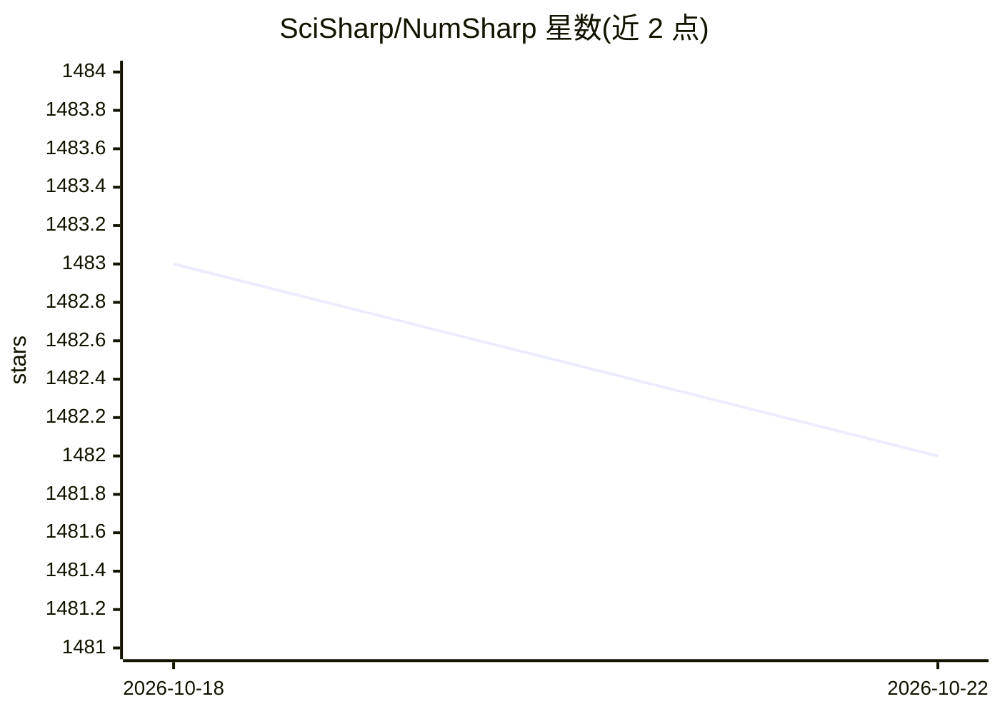

# SciSharp/NumSharp

⭐ 1,482 · C# · Apache-2.0 · 推送 2026-10-15 · [GitHub](https://github.com/SciSharp/NumSharp) · [官网](https://scisharp.github.io/NumSharp/) · 组织维护

**.NET 平台的 NumPy 风格 N 维张量计算库**

面向 C#/F# 的原生 .NET 数组库，提供与 NumPy 形状一致的 API：NDArray、广播、切片视图、dtype 感知的 np.* 函数、非托管存储，以及运行时 IL 生成内核与 SIMD CPU 加速。兼容目标是 NumPy 2.x，行为不一致时以 NumPy 为准。适用于科学计算与机器学习基础设施。通过 NuGet（dotnet add package）安装，CI 覆盖 Windows/Linux/macOS 的 net8.0 与 net10.0。不桥接 CPython，需要完整 CPython 运行时者可另选 Numpy.NET。

## 筛选速览

| 维度 | 判定 | 备注 |
|---|---|---|
| AI 角色 | `ai-ecosystem` | LLM/agent 周边工具 |
| 许可风险 | `permissive` | Apache-2.0 |
| 部署形态 | `None` |  |
| 模型依赖 | — | README 未给出锁定关系 |
| 硬件要求 | — | 无带数字的原话,不猜 |
| 安装摩擦 | `medium` | 含编译或系统依赖之一 |
| 成熟度 | — | 结构信号不足 |

## 能力要点

- NumPy 风格 NDArray、广播、切片视图与 15 种核心 dtype
- 运行时 IL 生成内核与 SIMD CPU 加速
- 以 NumPy 2.x 为兼容目标与行为基准
- 发布跟踪式基准快照与 API 覆盖率仪表板

## 适用场景

- 在 .NET 项目中使用 NumPy 风格数组运算而不嵌入 CPython
- 为 C#/F# 科学计算与机器学习基础设施提供数值底座
- 对照 NumPy 代码将数值逻辑移植到 .NET

## 场景标签

 · 领域:数值计算/.NET 库

## 证据(README 行号)

> L25: NumSharp lets C# and F# code use a NumPy-like programming model without embedding
> L27: learning infrastructure, and projects that want NumPy-style array operations in

## 星数曲线

2026-10-18 1,483 → 2026-10-22 1,482（-1）

---
*卡片 v1 · prompt 1.4 · 生成 2026-10-21 · 置信度 high · 依据 README sha `c7088f3af5fc` · [字段定义](../../DATASET.md)*
