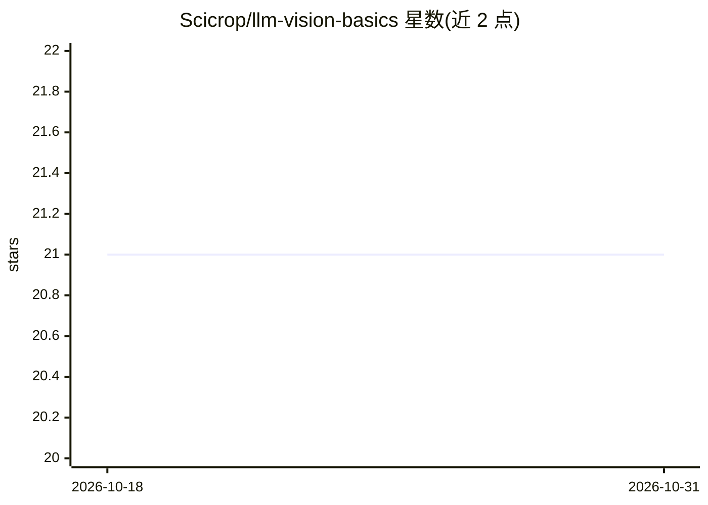

# Scicrop/llm-vision-basics

⭐ 21 · Jupyter Notebook · Apache-2.0 · 推送 2026-03-25 · [GitHub](https://github.com/Scicrop/llm-vision-basics) · 组织维护

**从零实现 LLM 与视觉模型的教学 notebook 合集（6 个）**

面向有 Python 基础知识的学习者的教育性 notebook 集合：从纯标准库实现的二元语法语言模型开始，依次演示上下文窗口局限、RNN/LSTM（含梯度消失模拟）、NumPy 手写注意力机制、PyTorch 实现的真实 Transformer（含逐层逐头注意力权重可视化）、CNN 与 DDPM 扩散过程。每课围绕巴西农业语料展开，强调机制而非规模化训练；README 明确说明不覆盖 RLHF、fine-tuning 或 ChatGPT 的端到端工作方式。

## 筛选速览

| 维度 | 判定 | 备注 |
|---|---|---|
| AI 角色 | `ai-knowledge` | 知识聚合/清单类 |
| 许可风险 | `permissive` | Apache-2.0 |
| 部署形态 | `library` | 以包/库形式分发 |
| 模型依赖 | — | README 未给出锁定关系 |
| 硬件要求 | — | 无带数字的原话,不猜 |
| 安装摩擦 | `low` | 无编译、无系统依赖或容器化 |
| 成熟度 | — | 结构信号不足 |

## 能力要点

- 6 个 notebook 覆盖 bigram→RNN/LSTM→注意力→Transformer→CNN/DDPM
- 第一个 notebook 仅用 Python 标准库实现语言模型
- 注意力公式逐行实现并提供表格/热力图/权重文本三种可视化
- Transformer 手写 W_Q/W_K/W_V/W_O 投影并提取真实训练后的注意力权重

## 适用场景

- 想理解 LLM 内部机制而非只用 API 的开发者
- 课程或自学中演示注意力、梯度消失、扩散模型等概念
- 评估 LLM 能力边界前的机制学习

## 场景标签

`教程课程` · 领域:学习与行业

## 证据(README 行号)

> L19: Construí seis notebooks que percorrem, do zero, a lógica interna de modelos de linguagem e visão. Qualquer pessoa c
> L41: ## 📓 Os seis notebooks

## 星数曲线

2026-10-18 21 → 2026-10-31 21（+0）

---
*卡片 v1 · prompt 1.4 · 生成 2026-10-28 · 置信度 mid · 依据 README sha `9de7a7ac73b2` · [字段定义](../../DATASET.md)*
