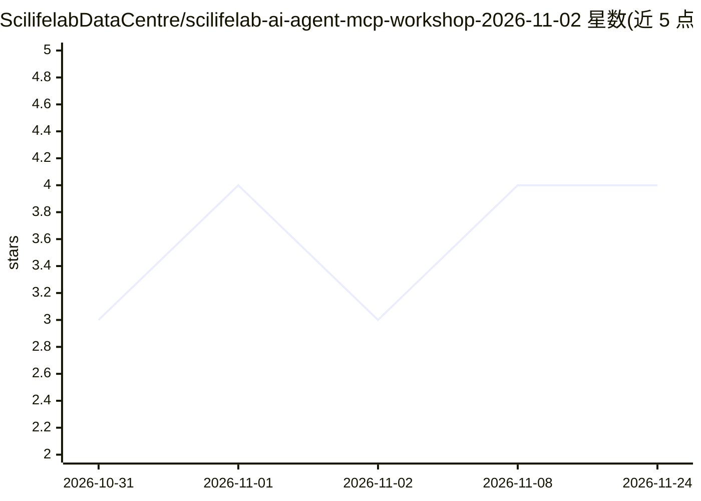

# ScilifelabDataCentre/scilifelab-ai-agent-mcp-workshop-2026-11-02

⭐ — · [GitHub]() · 组织维护

**面向生命科学研究者的 AI Agent 开发线下工作坊材料**

SciLifeLab Data Centre 于 2026-11-02 在 Lund 举办的线下实操工作坊「Developing AI Agents in Life Sciences」的配套仓库：包含议程、讲者信息、演示文稿下载入口，以及两个会话目录——用 LangGraph 与 ReAct 模式构建药物发现 Agent、用 MCP 接入科学文献检索工具。所有材料通过预构建 Docker 镜像运行（含 JupyterLab，端口 7860），无需本地 Python 环境；学员需自带笔记本电脑并持有 SciLifeLab OpenLLM 试点项目的 API key。

## 筛选速览

| 维度 | 判定 | 备注 |
|---|---|---|
| AI 角色 | `ai-knowledge` | 知识聚合/清单类 |
| 许可风险 | `permissive` | — |
| 部署形态 | `desktop` | 安装包/桌面程序 |
| 模型依赖 | — | README 未给出锁定关系 |
| 硬件要求 | — | 无带数字的原话,不猜 |
| 安装摩擦 | `low` | 无编译、无系统依赖或容器化 |
| 成熟度 | — | 结构信号不足 |

## 能力要点

- 两个实操会话：LangGraph+ReAct 药物发现 Agent、MCP 接入文献检索工具
- 全部材料经 Docker 容器运行，无需本地 Python 环境搭建
- 接入 SciLifeLab OpenLLM 试点 API，可替换为 OpenAI key
- 每个会话目录含独立详细 README 指引

## 适用场景

- 为生命科学研究人员开设 AI Agent 入门实操培训
- 学习用 LangGraph 构建科研工作流 Agent
- 学习用 MCP 将文献检索工具接入 Agent

## 场景标签

`Agent 框架` `科研工具` `教程课程` · 领域:Agent 开发

## 证据(README 行号)

> L11: We are delighted to invite you to our hands-on workshop on **Developing AI Agents in Life Sciences**, organised by 
> L50: - Hands-on tutorials with reasoning models, LangGraph, and MCP servers
> L91: All workshop materials run inside Docker containers. **No local Python environment setup is required.**

## 星数曲线

2026-10-31 3 → 2026-11-24 4（+1）

---
*卡片 v1 · prompt 1.4 · 生成 2026-11-21 · 置信度 high · 依据 README sha `2baedb0b8590` · [字段定义](../../DATASET.md)*
