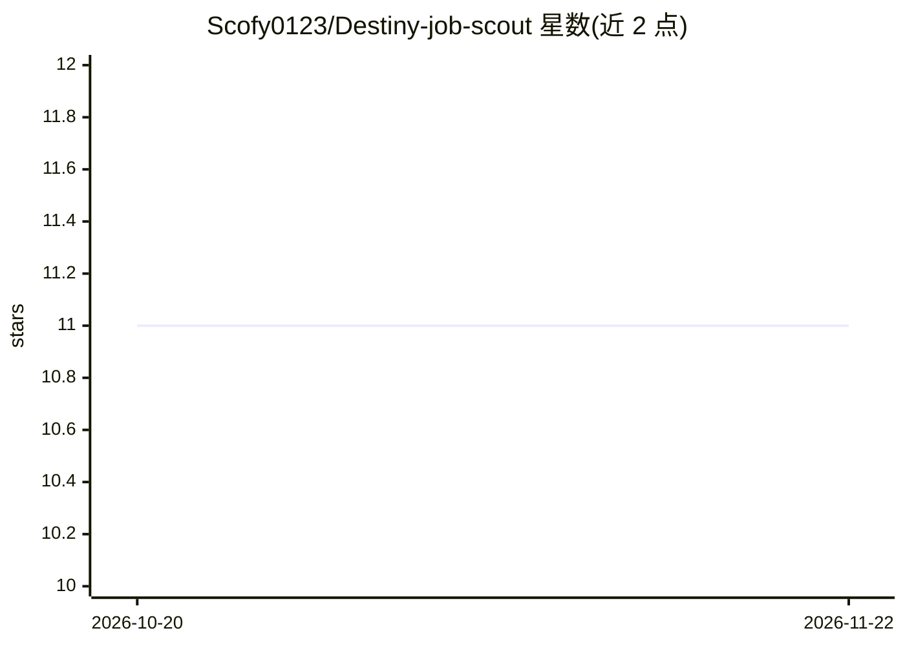

# Scofy0123/Destiny-job-scout

⭐ 11 · Python · 推送 2026-04-08 · [GitHub](https://github.com/Scofy0123/Destiny-job-scout) · 个人维护 · 中文 README

**面向求职者的 AI 岗位筛选推送工具，对接 Boss直聘与飞书**

基于 Agent 与 LLM 的求职辅助系统：通过 opencli 与 Chrome 插件读取 Boss直聘登录态抓取岗位 JD，将用户脱敏简历与职业偏好作为 System Prompt 输入大模型进行岗位评判，结果经飞书机器人推送。提供 Rich 交互式初始化向导构建配置，三个脚本按序执行可挂载 crontab 定时运行。前置依赖 Node.js v18+、opencli 与 lark-cli，README 另含登录 Session 失效时的排查步骤。

## 筛选速览

| 维度 | 判定 | 备注 |
|---|---|---|
| AI 角色 | `ai-native` | 本体是模型或模型工具 |
| 许可风险 | `none` | — |
| 部署形态 | `library` | 以包/库形式分发 |
| 模型依赖 | — | README 未给出锁定关系 |
| 硬件要求 | — | 无带数字的原话,不猜 |
| 安装摩擦 | `low` | 无编译、无系统依赖或容器化 |
| 成熟度 | — | 结构信号不足 |

## 能力要点

- 交互式终端向导生成求职偏好配置（Rich/questionary）
- 抓取 Boss直聘岗位 JD 并由大模型按个人画像评判
- 飞书机器人推送岗位点评结果
- 支持 crontab 定时执行三阶段脚本

## 适用场景

- 定时自动筛选 Boss直聘上的新岗位并收到推送
- 按个人简历与避雷偏好过滤岗位
- 用飞书接收每日岗位简报

## 场景标签

`网页抓取` · 领域:效率与自动化

## 证据(README 行号)

> L9: **DestinyScout: AI 个性化猎头系统 V1.0** 不是一个简单的脚本，它是你的**全自动私人 AI 猎头战车**。系统通过仿生学雷达无缝穿透风控，强行扒取近千字完整 JD，最后利用 Agent 原生大模型结合你的「
> L22: - 🧠 **大模型判官机 (Agent-Native LLM Judges)**: 你的脱敏简历和职业雷区会被浓缩成最高权重的 System Prompt。遇到画大饼的公司？大模型会在推片日志里毫不留情地为你揭穿。
> L23: - 🚀 **极速对讲机直推**: 脱水后的高纯度合伙人点评、核心杠杆、潜在避坑点，通过飞书机器人直接触达你的手机。

## 星数曲线

2026-10-20 11 → 2026-11-22 11（+0）

---
*卡片 v1 · prompt 1.4 · 生成 2026-11-18 · 置信度 mid · 依据 README sha `a745117c9e6c` · [字段定义](../../DATASET.md)*
