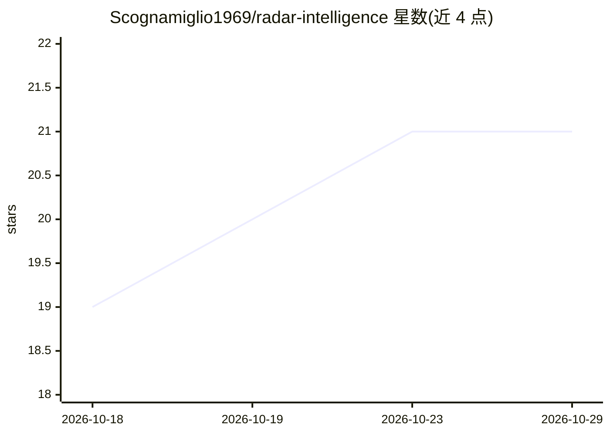

# Scognamiglio1969/radar-intelligence

⭐ 21 · TypeScript · AGPL-3.0 · 推送 2026-09-17 · [GitHub](https://github.com/Scognamiglio1969/radar-intelligence) · 个人维护 · 中文 README

**可自托管的开源媒体情报与社媒监听平台，替代 Talkwalker/Brandwatch**

基于 Next.js 的自托管媒体情报与社交监听应用，面向品牌与传播团队。支持 25 个免费数据源采集（Listening）、导入 Excel/CSV（Import）以及直接读取 Talkwalker 项目的主题（消耗其 API credits）。AI 功能包括：自然语言转布尔查询的 query builder（也可用规则解析器无 AI 运行）、Point of View 观点报告、报告图表的 AI 评注；AI 引擎可选 Claude、OpenAI 或 Grok，自带 API key。另有 Studio Graph 自定义图表、PDF/Excel/Word/PowerPoint 导出、KPI 可靠性判定与 AI Act 披露。AGPL v3 许可。

## 筛选速览

| 维度 | 判定 | 备注 |
|---|---|---|
| AI 角色 | `ai-enhanced` | 去掉 AI 部分产品仍成立 |
| 许可风险 | `viral` | AGPL-3.0 |
| 部署形态 | `library` | 以包/库形式分发 |
| 模型依赖 | locked-api |  |
| 硬件要求 | — | 无带数字的原话,不猜 |
| 安装摩擦 | `low` | 无编译、无系统依赖或容器化 |
| 成熟度 | — | 结构信号不足 |

## 能力要点

- 自然语言一句话生成并实测布尔查询（Google News 7 天真实数据测试）
- AI 引擎三选一：Claude / OpenAI / Grok，应用内填 key 即用
- 三种项目模式：自采集、Excel/CSV 导入（自动识别列语义）、读取 Talkwalker 话题
- Studio Graph 自定义三维图表与 16 组可视化，导出带 AI Act 披露

## 适用场景

- 团队想自托管社媒监听，替代按月收费的 Talkwalker/Brandwatch
- 把一句话的监测需求转成可测试的布尔查询并在真实新闻上验证
- 导入已有的 Excel/CSV 舆情数据并生成带 AI 评注的中文或英文报告

## 场景标签

`数据分析` `网页抓取` · 领域:效率与自动化

## 证据(README 行号)

> L47: off, rename it, add a block by hand, or start from scratch without the AI at all (a rule-based
> L92: Pick your AI engine — Claude, OpenAI or Grok — enter its key and set the models, all from

## 星数曲线

2026-10-18 19 → 2026-10-29 21（+2）

---
*卡片 v1 · prompt 1.4 · 生成 2026-10-28 · 置信度 low · 依据 README sha `714b9f5ec6b0` · [字段定义](../../DATASET.md)*
