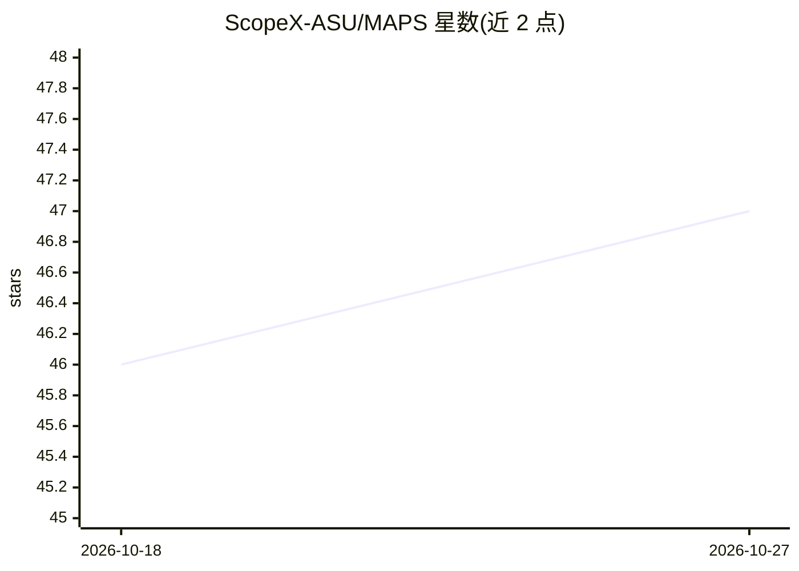

# ScopeX-ASU/MAPS

⭐ 47 · Python · MIT · 推送 2026-07-24 · [GitHub](https://github.com/ScopeX-ASU/MAPS) · 组织维护

**给光子学研究者的多保真 AI 光子仿真与逆向设计框架**

DATE 2025 论文的官方实现，面向光子集成电路器件的仿真与逆向设计。含三个组件：MAPS-Data 生成含正向场、伴随场、S 参数等标注的多保真器件数据集；MAPS-Train 提供层次化数据加载、可定制模型与数据/物理驱动损失的训练框架（如 Fourier 神经算子预测 Maxwell 方程场分布）；MAPS-InvDes 提供伴随法逆向设计工具包，可集成训练好的 AI 模型加速设计并含制造偏差模型。集成 ceviche、Tidy3D、fdtdx 等求解器，支持 GPU 3D FDTD。通过 git clone 源码安装，需 Python 3.11+，部分功能依赖私有内部 fdtdx-adjoint 库。

## 筛选速览

| 维度 | 判定 | 备注 |
|---|---|---|
| AI 角色 | `ai-ecosystem` | LLM/agent 周边工具 |
| 许可风险 | `permissive` | MIT |
| 部署形态 | `None` |  |
| 模型依赖 | — | README 未给出锁定关系 |
| 硬件要求 | — | 无带数字的原话,不猜 |
| 安装摩擦 | `low` | 无编译、无系统依赖或容器化 |
| 成熟度 | — | 结构信号不足 |

## 能力要点

- MAPS-Data 生成多保真、多标注的光子器件仿真数据集
- MAPS-Train 支持 Fourier 神经算子等 AI 模型训练与数据/物理驱动损失
- MAPS-InvDes 伴随法逆向设计，可接入预训练 AI 模型与制造偏差模型
- 集成 ceviche/Tidy3D/fdtdx 求解器，支持 GPU 加速 3D FDTD 与伴随优化

## 适用场景

- 逆向设计波导弯曲等光子器件并生成优化结果
- 生成带扰动标注的光子仿真数据集用于 AI for optics 研究
- 训练神经算子模型做 Maxwell 方程正向场预测

## 场景标签

 · 领域:光子学/科学计算

## 证据(README 行号)

> L46: Inverse design has emerged as a transformative approach for photonic device optimization, enabling the exploration 
> L50: **MAPS-Train** supports AI model training using MAPS-Data as datasets for AI-assisted photonic device simulation an
> L53: **MAPS-InvDes** is a framework with full support of simulation and adjoint-based inverse design. Users can use the 

## 星数曲线

2026-10-18 46 → 2026-10-27 47（+1）

---
*卡片 v1 · prompt 1.4 · 生成 2026-10-25 · 置信度 high · 依据 README sha `8499bb498890` · [字段定义](../../DATASET.md)*
