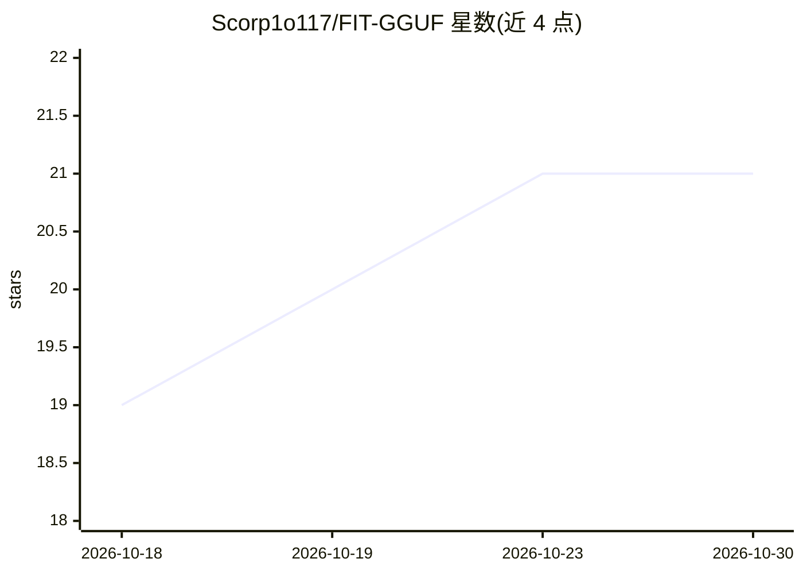

# Scorp1o117/FIT-GGUF

⭐ 21 · Python · MIT · 推送 2026-10-22 · [GitHub](https://github.com/Scorp1o117/FIT-GGUF) · 个人维护 · 中文 README

**按字节预算对 GGUF 做确定性混合量化的规划工具**

面向 llama.cpp GGUF 生态的量化规划层：从预设量化档出发，在给定字节预算内做确定性的张量级精度升级，产出可复现的精确尺寸 GGUF 及其 recipe、tensor override 与 SHA-256 溯源。v0.2 起提供保真度分档（Quality/Balanced/Compact/Mini，以宏观 KL 为硬门限），搜索最小通过尺寸并校验最终产物；v0.3 增加一条命令的模型校准流程与 Calibration Bundle；v0.5 提供 FIT Studio 桌面应用。README 明确声明通用最优张量分配未成立，尺寸预测已在 22 个目标上验证零字节误差。

## 筛选速览

| 维度 | 判定 | 备注 |
|---|---|---|
| AI 角色 | `ai-ecosystem` | LLM/agent 周边工具 |
| 许可风险 | `permissive` | MIT |
| 部署形态 | `desktop` | 安装包/桌面程序 |
| 模型依赖 | local-ok | 支持本地模型 |
| 硬件要求 | — | 无带数字的原话,不猜 |
| 安装摩擦 | `medium` | 含编译或系统依赖之一 |
| 成熟度 | — | 结构信号不足 |

## 能力要点

- 字节预算到 GGUF 尺寸的确定性规划与零误差尺寸预测（22/22 目标验证）
- 保真度分档（KL 硬门限）下搜索最小通过尺寸并对最终产物做校验
- fit calibrate 一条命令完成模型校准，产出含 SHA-256 溯源的 Calibration Bundle
- FIT Studio Windows 桌面应用，无需单独安装 Python

## 适用场景

- 把模型压到指定显存/磁盘字节预算并获得可复现的 GGUF
- 按保真度档位找最小可验证的量化产物
- 为新模型生成校准记录并纳入质量搜索流程

## 场景标签

`模型量化` · 领域:训练与推理

## 证据(README 行号)

> L7:  A deterministic planning layer that turns llama.cpp quantization presets into a near-continuous model-size control.
> L11: Standard GGUF quantization asks you to choose a preset. FIT-GGUF starts from
> L80: `fit fidelity-search` walks the healthy preset frontier (poison presets

## 星数曲线

2026-10-18 19 → 2026-10-30 21（+2）

---
*卡片 v1 · prompt 1.4 · 生成 2026-10-28 · 置信度 high · 依据 README sha `411a990a643d` · [字段定义](../../DATASET.md)*
