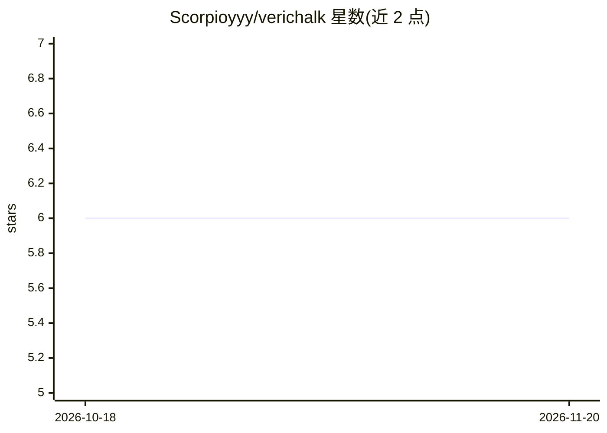

# Scorpioyyy/verichalk

⭐ — · [GitHub]() · 个人维护 · 中文 README

**给小学数学老师：生成答案经核验、不超纲的题目与试卷**

VeriChalk 是面向小学数学教师的出题 Agent：接受一句话描述或练习册照片，生成题目、综合题与整份试卷。核验链路为结构检查、沙箱内求解程序精确计算、另一个模型独立盲解，两者一致才标记已核验，不通过则修复或换题；同时做超纲检查与题面评审。课程知识来自 ChalkBase（北师大版 1～6 年级）。支持在线修改、PDF/Word/Markdown/LaTeX 导出、带模型调用与核验证据的调试台。需要 Python ≥3.11、Node ≥20 和阿里云百炼 API 密钥。README 还报告了与通用大模型直接出题的对比评测数据。

## 筛选速览

| 维度 | 判定 | 备注 |
|---|---|---|
| AI 角色 | `ai-native` | 本体是模型或模型工具 |
| 许可风险 | `permissive` | — |
| 部署形态 | `library` | 以包/库形式分发 |
| 模型依赖 | locked-api |  |
| 硬件要求 | — | 无带数字的原话,不猜 |
| 安装摩擦 | `low` | 无编译、无系统依赖或容器化 |
| 成熟度 | — | 结构信号不足 |

## 能力要点

- 求解程序与独立盲解双重核验，一致才标已核验
- 按课时边界做超纲检查，知识点取自知识图谱
- 拍照转写练习册并照题出新题，支持看图题
- 调试台可展开到单次模型调用与核验证据

## 适用场景

- 按课时和难度要求一句话生成练习题
- 拍练习册照片生成同类型新题
- 按细目表组整份试卷并导出教师版/学生版

## 场景标签

 · 领域:教育/小学数学工具

## 证据(README 行号)

> L3: **面向小学数学教师的可验证命题 Agent**
> L69: - **核验**：结构检查 → 求解程序（沙箱内精确计算）→ 独立盲解、超纲检查、题面评审并行。求解程序与盲解一致才标"已核验"；不通过就带着问题修复，修不好就换一道。
> L112: |模型|阿里云百炼：qwen3.7-plus（写题）· deepseek-v4.1-flash（理解与核验）· qwen3.8-flash（识图）|

## 星数曲线

2026-10-18 6 → 2026-11-20 6（+0）

---
*卡片 v1 · prompt 1.4 · 生成 2026-11-20 · 置信度 high · 依据 README sha `988af148395e` · [字段定义](../../DATASET.md)*
