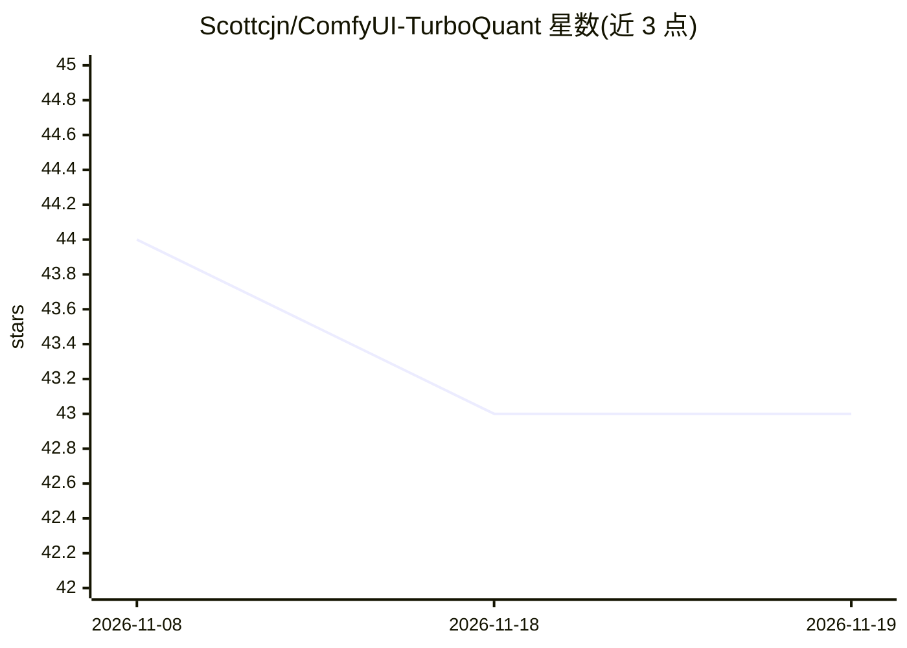

# Scottcjn/ComfyUI-TurboQuant

⭐ 43 · Python · MIT · 推送 2026-08-20 · [GitHub](https://github.com/Scottcjn/ComfyUI-TurboQuant) · [官网](https://elyanlabs.ai) · 个人维护

**ComfyUI 节点：TQ3 三比特量化压缩注意力 KV cache**

实验性 ComfyUI 自定义节点，将注意力 K/V 张量经 TQ3 量化（3-bit Lloyd-Max 码书 + Fast Walsh-Hadamard 变换去相关）往返压缩，宣称 KV cache 显存约降 4.5x（FP16 → 有效 3.5 bit），使 LTX-2.3 22B 可在 V100 32GB 上运行。暴露 TurboQuant KV Patch 与 TurboQuant Info 两个节点。作者自述非持久化 KV cache，仅适用于质量与压缩实验。安装方式为符号链接到 custom_nodes 目录，提供自测与 pytest。

## 筛选速览

| 维度 | 判定 | 备注 |
|---|---|---|
| AI 角色 | `ai-ecosystem` | LLM/agent 周边工具 |
| 许可风险 | `permissive` | MIT |
| 部署形态 | `None` |  |
| 模型依赖 | — | README 未给出锁定关系 |
| 硬件要求 | — | 无带数字的原话,不猜 |
| 安装摩擦 | `low` | 无编译、无系统依赖或容器化 |
| 成熟度 | `idea` | |

## 能力要点

- 3-bit Lloyd-Max 量化 + FWHT 去相关，128 浮点块压至 56 字节
- 往返余弦相似度 >0.97（典型注意力向量）
- 暴露 KV Patch 与 Info 两个 ComfyUI 节点
- 提供 python -m 自测与 pytest 测试

## 适用场景

- 在 V100 32GB 上运行 LTX-2.3 22B 视频生成模型
- 实验 KV cache 压缩对生成质量的影响
- 查看推理时的压缩统计数据

## 场景标签

`模型量化` · 领域:训练与推理

## 证据(README 行号)

> L5: > **Answer-first:** ComfyUI-TurboQuant is an experimental ComfyUI custom node that round-trips attention K/V tensors
> L7: TQ3 KV cache compression for ComfyUI. Reduces attention KV cache VRAM by ~4.5x using 3-bit Lloyd-Max quantization wi

## 星数曲线

2026-11-08 44 → 2026-11-19 43（-1）

---
*卡片 v1 · prompt 1.4 · 生成 2026-11-18 · 置信度 high · 依据 README sha `ed7b99b8f053` · [字段定义](../../DATASET.md)*
