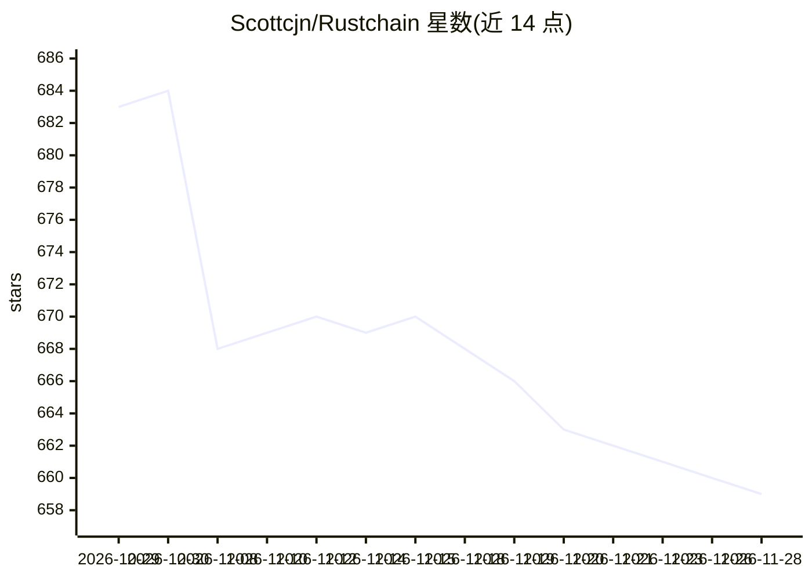

# Scottcjn/Rustchain

⭐ 659 · Python · Apache-2.0 · 推送 2026-11-26 · [GitHub](https://github.com/Scottcjn/Rustchain) · [官网](https://rustchain.org) · 组织维护 · 中文 README

**为 AI agent 提供硬件证明身份的抗女巫区块链网络**

RustChain 是一条采用 Proof-of-Antiquity 共识的 Layer-1 区块链，通过振荡器漂移、缓存时序、热熵等 6 项硬件指纹校验验证物理机真实存在，防止 VM/模拟器农场伪装；旧硬件获得更高出块乘数，奖励机器保存而非算力。面向 AI 团队与 agent 开发者，提供硬件证明的 agent 身份、RTC 原生代币微支付、Beacon agent 发现协议，以及 LangChain/CrewAI 等框架集成工具。Solana 桥（wRTC）当前处于禁用状态。

## 筛选速览

| 维度 | 判定 | 备注 |
|---|---|---|
| AI 角色 | `ai-ecosystem` | LLM/agent 周边工具 |
| 许可风险 | `permissive` | Apache-2.0 |
| 部署形态 | `library` | 以包/库形式分发 |
| 模型依赖 | — | README 未给出锁定关系 |
| 硬件要求 | — | 无带数字的原话,不猜 |
| 安装摩擦 | `low` | 无编译、无系统依赖或容器化 |
| 成熟度 | — | 结构信号不足 |

## 能力要点

- 6 项硬件指纹校验（时钟漂移/缓存时序/SIMD/热熵等）区分真实硅片与 VM
- Proof-of-Antiquity：硬件越老乘数越高，覆盖 15+ CPU 架构
- agent 签名密钥即钱包，支持 RTC 微支付与 agent 间直接结算
- 提供 LangChain pip 包及 CrewAI/AutoGen/Agno/smolagents 集成

## 适用场景

- 为自主 AI agent 建立可验证的硬件身份
- agent 间微支付与机器对机器结算
- 验证 agent 声称的推理/渲染任务确实在真实硬件上执行

## 场景标签

 · 领域:区块链/DePIN/AI agent 基础设施

## 证据(README 行号)

> L48: The token is the least interesting thing here. RustChain is a **novel Layer-1 consensus** (Proof of Antiquity) — no
> L192: |**Frameworks**|Drop-in tools so any agent can query the network — LangChain (`pip install langchain-rustchain-too

## 星数曲线

2026-10-29 683 → 2026-11-28 659（-24）

---
*卡片 v1 · prompt 1.4 · 生成 2026-11-25 · 置信度 mid · 依据 README sha `3d54f314d5b3` · [字段定义](../../DATASET.md)*
