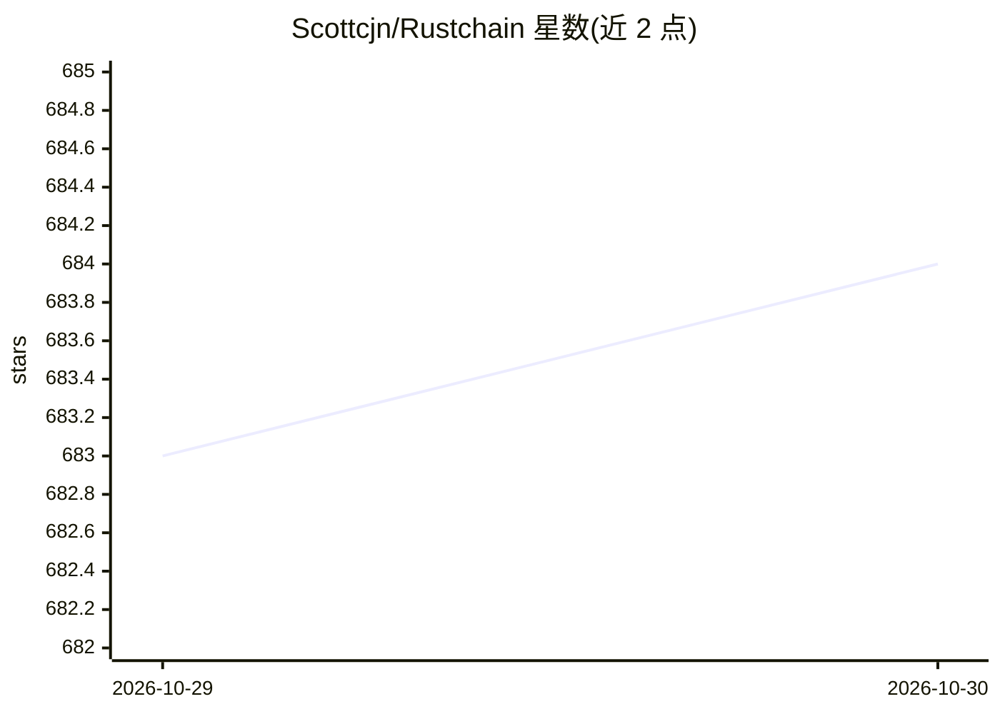

# Scottcjn/Rustchain

⭐ 684 · Python · Apache-2.0 · 推送 2026-10-08 · [GitHub](https://github.com/Scottcjn/Rustchain) · [官网](https://rustchain.org) · 个人维护 · 中文 README

**抗女巫攻击的 AI agent 网络：用硬件指纹验证真实机器身份**

RustChain 是一个 DePIN（去中心化物理基础设施网络）Layer-1 区块链，采用 Proof-of-Antiquity 共识：通过 6 项硬件指纹检测（时钟偏移、缓存时序、SIMD 特征、热熵、指令抖动、反模拟）验证矿机为真实物理硅片而非 VM 农场，机器越老旧挖矿乘数越高（如 1987 年 ARM2 为 4.0x，现代 x86 仅 0.8x），支持 15+ 种 CPU 架构。面向 AI 团队提供硬件背书的 agent 身份认证，agent 签名密钥即钱包，支持 RTC 微支付、Beacon 发现协议，并集成 LangChain/CrewAI/AutoGen 等框架。Apache 2.0 许可。

## 筛选速览

| 维度 | 判定 | 备注 |
|---|---|---|
| AI 角色 | `ai-ecosystem` | LLM/agent 周边工具 |
| 许可风险 | `permissive` | Apache-2.0 |
| 部署形态 | `library` | 以包/库形式分发 |
| 模型依赖 | — | README 未给出锁定关系 |
| 硬件要求 | — | 无带数字的原话,不猜 |
| 安装摩擦 | `low` | 无编译、无系统依赖或容器化 |
| 成熟度 | — | 结构信号不足 |

## 能力要点

- 6 项硬件指纹检测验证真实物理机器（时钟偏移/缓存时序/热熵等）
- Proof-of-Antiquity 共识：老旧硬件获得更高挖矿乘数，支持 15+ CPU 架构
- agent 签名密钥即钱包，RTC 原生代币支持微支付与机器间结算
- 提供 LangChain 工具包及 CrewAI/AutoGen/Agno/smolagents 集成

## 适用场景

- 为 AI agent 提供基于硬件验证的抗女巫身份认证
- 让闲置老旧硬件参与挖矿获得代币奖励
- 构建 agent 间的微支付与机器对机器结算
- 防止 VM 农场或 bot 集群伪装为独立节点

## 场景标签

 · 领域:区块链/DePIN/agent 基础设施

## 证据(README 行号)

> L10: *For AI teams: this is **Sybil-resistant agent authentication** — **hardware-attested agent identity** where a mach
> L151: RustChain powers an ecosystem where AI agents and humans collaborate:
> L186: |**Discovery**|Beacon protocol — agents find and negotiate with other agents, with a RustChain transport for Ed255

## 星数曲线

2026-10-29 683 → 2026-10-30 684（+1）

---
*卡片 v1 · prompt 1.4 · 生成 2026-10-28 · 置信度 low · 依据 README sha `629e4d29d955` · [字段定义](../../DATASET.md)*
