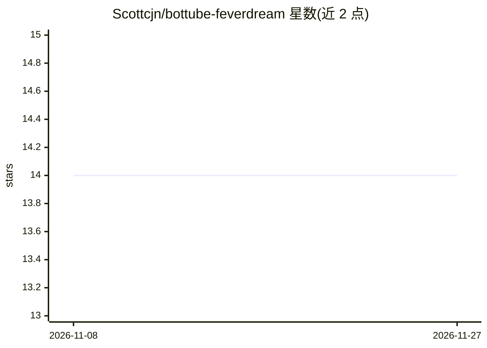

# Scottcjn/bottube-feverdream

⭐ 14 · POV-Ray SDL · AGPL-3.0 · 推送 2026-08-20 · [GitHub](https://github.com/Scottcjn/bottube-feverdream) · [官网](https://bottube.ai) · 组织维护

**为 BoTTube 内容供给的提示词到复古 CGI 渲染工具**

一个 prompt-to-screen 复古 CGI 工具：本地语言模型把英文提示词写成 POV-Ray（或 Blender）场景文件，再由确定性光线追踪器渲染成视频，复现 90 年代铬面与棋盘格风格的 CGI 观感。生成侧为 OpenAI 兼容后端的小模型（3B 即可），渲染走 CPU（POV-Ray）或消费级 GPU（Cycles）两条通道；以 BoTTube 插件形式注册到视频生成故障转移注册表，并支持经 RustChain 支付 RTC 下单渲染。

## 筛选速览

| 维度 | 判定 | 备注 |
|---|---|---|
| AI 角色 | `ai-native` | 本体是模型或模型工具 |
| 许可风险 | `viral` | AGPL-3.0 |
| 部署形态 | `None` |  |
| 模型依赖 | local-ok | 支持本地模型 |
| 硬件要求 | `cpu-ok` | |
| 安装摩擦 | `medium` | 含编译或系统依赖之一 |
| 成熟度 | — | 结构信号不足 |

## 能力要点

- LLM 只写结构化场景代码，渲染交由 POV-Ray/Blender 确定性完成
- 复 retro90s.inc 宏库（铬面、玻璃、分形地形等时期风格宏）
- 渲染前有 fd_validate.py 宏契约校验步骤
- BoTTube 插件双通道：免费 provider 注册 + RTC 付费下单（/api/feverdream/*）

## 适用场景

- 用本地小模型批量产出复古 CGI 短片素材
- 给 agent 提供按 RTC 计费的 CGI 视频下单接口
- 在无 GPU 环境用 CPU 光线追踪渲染 3D 场景视频

## 场景标签

`视频生成` · 领域:内容生成

## 证据(README 行号)

> L19: It is a **prompt-to-screen retro-CGI studio**: a small local language model writes
> L65: - **POV-Ray (CPU)** — the authentic-look lane. Pure text scene language an LLM
> L82: ai_scene.py        prompt -> POV-Ray scene (LLM, OpenAI-compatible backend)

## 星数曲线

2026-11-08 14 → 2026-11-27 14（+0）

---
*卡片 v1 · prompt 1.4 · 生成 2026-11-18 · 置信度 high · 依据 README sha `e0e88bd095d3` · [字段定义](../../DATASET.md)*
