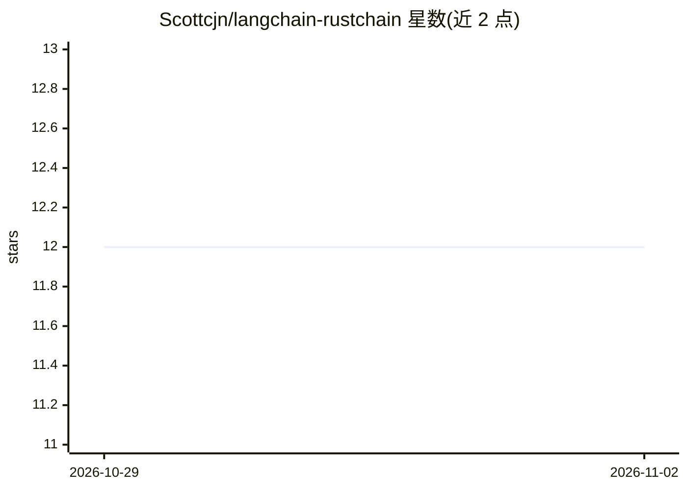

# Scottcjn/langchain-rustchain

⭐ 12 · Python · MIT · 推送 2026-07-10 · [GitHub](https://github.com/Scottcjn/langchain-rustchain) · 个人维护

**让 LangChain agent 只读查询 RustChain 链上数据的工具集**

面向 LangChain 生态的 Python 集成包：将 RustChain（DePIN 区块链，Proof-of-Antiquity 挖矿）的公开只读 HTTP 端点封装为 9 个 LangChain 工具，覆盖网络统计、 payouts、矿工、节点健康、epoch、余额、赏金、硬件古董榜与来源证明查询；明确不做签名、转账或密钥管理。工具返回精简摘要而非原始 JSON，另导出框架无关的 RustChainClient 与 summarize 辅助函数，支持 httpx 异步并发读取与离线 fixture 模式，可指向自建节点。

## 筛选速览

| 维度 | 判定 | 备注 |
|---|---|---|
| AI 角色 | `ai-ecosystem` | LLM/agent 周边工具 |
| 许可风险 | `permissive` | MIT |
| 部署形态 | `library` | 以包/库形式分发 |
| 模型依赖 | — | README 未给出锁定关系 |
| 硬件要求 | — | 无带数字的原话,不猜 |
| 安装摩擦 | `low` | 无编译、无系统依赖或容器化 |
| 成熟度 | — | 结构信号不足 |

## 能力要点

- 9 个只读工具：网络统计/挖矿/健康/epoch/余额/赏金/古董榜/来源证明
- 不签名、不转账、不管理密钥，仅公开数据面
- 框架无关 RustChainClient + summarize 辅助函数可不依赖 LangChain 使用
- 异步并发客户端与离线 fixture 模式（确定性 CI 输出）

## 适用场景

- 让 LangChain agent 回答 RustChain 网络规模、矿工与 payouts 问题
- 在 agent 中查询 RTC 余额与开放赏金任务
- 用 AsyncRustChainClient 并发读取多条链上事实

## 场景标签

 · 领域:区块链/DePIN 与 LLM 工具集成

## 证据(README 行号)

> L7: **langchain-rustchain is a read-only LangChain integration that lets Python
> L14: Drop these tools into any LangChain agent so it can answer questions about the
> L60: The framework-free `RustChainClient` and `summarize_*` helpers are also exported,

## 星数曲线

2026-10-29 12 → 2026-11-02 12（+0）

---
*卡片 v1 · prompt 1.4 · 生成 2026-11-01 · 置信度 high · 依据 README sha `d4056f51c6c9` · [字段定义](../../DATASET.md)*
