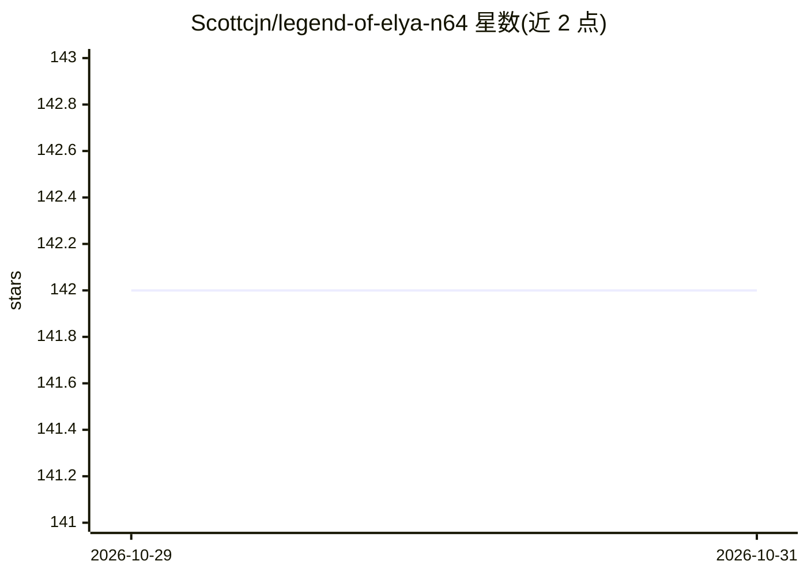

# Scottcjn/legend-of-elya-n64

⭐ 142 · C · MIT · 推送 2026-08-30 · [GitHub](https://github.com/Scottcjn/legend-of-elya-n64) · [官网](https://hackaday.io/project/206401-transformers-on-retro-game-consoles) · 个人维护

**在 N64 主机 CPU 上实时运行 transformer 的 AI NPC 游戏 ROM**

N64 自制游戏 ROM：塞尔达式地牢中玩家靠近 NPC Sophia Elya 按 A 触发对话，由 6.36M 参数、8 层 ternary 量化的 nano-GPT 在 MIPS R4300i CPU（93.75 MHz）上实时推理生成回答，无预计算应答表。权重 1,984 KB 存于卡带 ROM，float32 计算，标量构建 1.23 tok/s、RSP overlay 2.19 tok/s（均在 ares 模拟器中测量）。README 含大篇幅 tok/s 计数器勘误：早期公布的 61.8 tok/s 撤回，真实值为 1.2；当前 6.36M ternary 版本尚未在真机运行，Full Demo 视频为 819K Q8 版本实机录制。

## 筛选速览

| 维度 | 判定 | 备注 |
|---|---|---|
| AI 角色 | `ai-native` | 本体是模型或模型工具 |
| 许可风险 | `permissive` | MIT |
| 部署形态 | `None` |  |
| 模型依赖 | — | README 未给出锁定关系 |
| 硬件要求 | — | 无带数字的原话,不猜 |
| 安装摩擦 | `medium` | 含编译或系统依赖之一 |
| 成熟度 | — | 结构信号不足 |

## 能力要点

- 6.36M 参数 ternary 量化 GPT 在 MIPS R4300i CPU 上实时推理，无预计算应答
- 标量 1.23 tok/s、RSP overlay 2.19 tok/s、epilogue 重叠 3.03 tok/s（ares 实测）
- 权重 1,984 KB 存卡带 ROM，KV cache 256 KB RDRAM，总占用约 263 KB
- 公开勘误旧计数器错误（61.8 tok/s 为构造性常数，已撤回）

## 适用场景

- 在 ares 模拟器或 EverDrive 64 真机上体验带 AI 对话 NPC 的 N64 游戏
- 研究极限资源约束下的 transformer 推理实现（ternary 量化、Taylor exp、快速逆平方根）
- 作为复古主机上运行 LLM 的技术参考案例

## 场景标签

`模型量化` `推理引擎` · 领域:训练与推理

## 证据(README 行号)

> L7: An original N64 homebrew ROM featuring **Sophia Elya** — an AI NPC
> L8: powered by a nano-GPT transformer running **live inference on the MIPS R4300i CPU**.
> L31: - The N64 CPU runs a full 8-layer transformer: embedding → attention → FFN → logits → sampling

## 星数曲线

2026-10-29 142 → 2026-10-31 142（+0）

---
*卡片 v1 · prompt 1.4 · 生成 2026-10-28 · 置信度 high · 依据 README sha `5a469f20ce83` · [字段定义](../../DATASET.md)*
