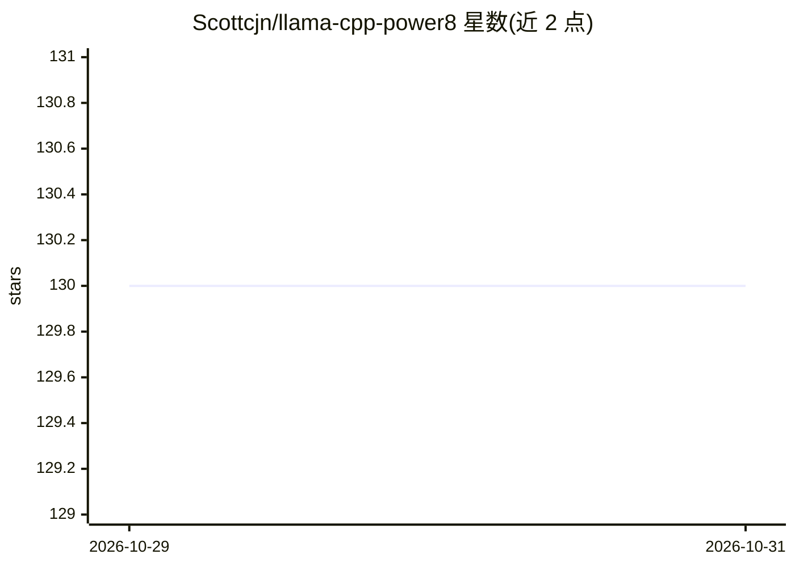

# Scottcjn/llama-cpp-power8

⭐ 130 · C · Apache-2.0 · 推送 2026-09-26 · [GitHub](https://github.com/Scottcjn/llama-cpp-power8) · [官网](https://rustchain.org) · 个人维护

**llama.cpp 的 IBM POWER8 优化补丁集：向量与缓存级提速推理**

面向 IBM POWER8 (ppc64le) 服务器的 llama.cpp 优化集合：提供 POWER9→POWER8 内在函数兼容层（power8-compat.h）、DCBT 缓存驻留预取头文件（ggml-dcbt-resident.h）、可选 IBM MASS 数学库集成与 AltiVec/VSX 基准程序。通过 vec_perm 非双射折叠与 PSE 硬件熵等技术实现 CPU 向量化推理，无 VSX 时自动回退标量路径。需自行 clone llama.cpp 源码并编译（Ubuntu 20.04、GCC、CMake 3.14+），属 Proof of Physical AI 技术栈的推理层。

## 筛选速览

| 维度 | 判定 | 备注 |
|---|---|---|
| AI 角色 | `ai-ecosystem` | LLM/agent 周边工具 |
| 许可风险 | `permissive` | Apache-2.0 |
| 部署形态 | `None` |  |
| 模型依赖 | local-ok | 支持本地模型 |
| 硬件要求 | — | 无带数字的原话,不猜 |
| 安装摩擦 | `high` | 编译与系统依赖俱全 |
| 成熟度 | — | 结构信号不足 |

## 能力要点

- POWER9→POWER8 内在函数兼容层（power8-compat.h）
- DCBT 缓存驻留预取提示与 128 字节对齐优化建议
- 可选集成 IBM MASS 数学库（-DGGML_USE_IBM_MASS）
- 无 VSX 环境自动回退标量浮点/整数路径

## 适用场景

- 在 IBM POWER8 服务器上本地编译运行 llama.cpp 推理
- 为老旧 POWER 硬件做 VSX/AltiVec 向量化性能调优
- 按线程数与缓存预取参数优化 POWER8 上的 tokens/s

## 场景标签

`推理引擎` · 领域:训练与推理

## 证据(README 行号)

> L30: **AltiVec/VSX Optimized LLM Inference for POWER8**
> L32: Run your own models on your own hardware. This provides POWER8-specific optimizations for llama.cpp, enabling effic
> L36: - **power8-compat.h** - POWER9 intrinsics compatibility layer for POWER8

## 星数曲线

2026-10-29 130 → 2026-10-31 130（+0）

---
*卡片 v1 · prompt 1.4 · 生成 2026-10-28 · 置信度 high · 依据 README sha `142295279cf9` · [字段定义](../../DATASET.md)*
