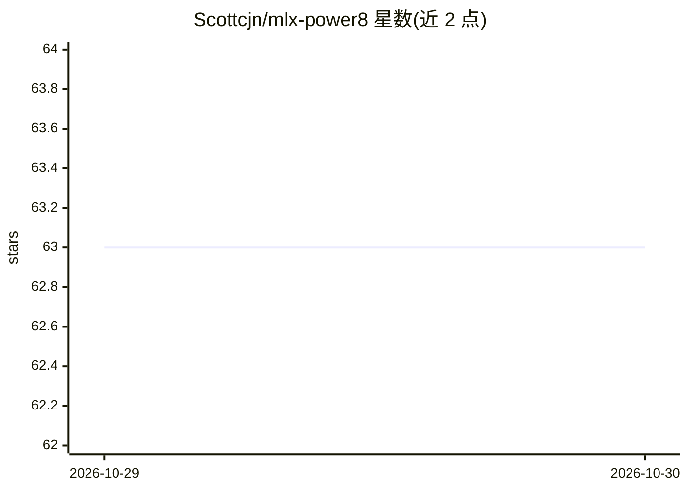

# Scottcjn/mlx-power8

⭐ 63 · C++ · Apache-2.0 · 推送 2026-08-06 · [GitHub](https://github.com/Scottcjn/mlx-power8) · [官网](https://rustchain.org) · 组织维护

**将 Apple MLX 移植到 POWER8/x86 Linux 的 SIMD 后端适配层**

由 Elyan Labs 维护的 MLX Linux 移植项目：为 POWER8/9 提供 VSX 128-bit 向量化、为 x86_64 提供 AVX 256-bit 向量化，并通过架构检测头文件支持多平台；ARM64 指向使用上游实现。使用方式为将 simd/ 目录内容复制到 MLX 源码树的 mlx/backend/cpu/simd/ 下重新构建，构建说明单独放在 BUILD_POWER8.md。作者说明 MLX 网络层基于标准 TCP 套接字本即可移植，仅需移植 SIMD 后端。无 pip/npm/docker 安装途径，需从源码编译。

## 筛选速览

| 维度 | 判定 | 备注 |
|---|---|---|
| AI 角色 | `ai-ecosystem` | LLM/agent 周边工具 |
| 许可风险 | `permissive` | Apache-2.0 |
| 部署形态 | `None` |  |
| 模型依赖 | — | README 未给出锁定关系 |
| 硬件要求 | — | 无带数字的原话,不猜 |
| 安装摩擦 | `low` | 无编译、无系统依赖或容器化 |
| 成熟度 | — | 结构信号不足 |

## 能力要点

- POWER8/9 VSX 128-bit SIMD 向量化实现
- x86_64 AVX 256-bit SIMD 向量化实现
- 提供架构自动检测头文件（type_linux.h）
- 以复制文件到 MLX 源码树并重新构建的方式使用

## 适用场景

- 在 IBM POWER8/9 (ppc64le) Linux 机器上构建和运行 MLX
- 在无 Apple Silicon 的 x86_64 Linux 环境使用 MLX 的 CPU 后端
- 参考 VSX/AVX 向量化代码为其他架构移植 MLX

## 场景标签

`推理引擎` · 领域:训练与推理

## 证据(README 行号)

> L6: Port of Apple's MLX to Linux with native SIMD optimizations.
> L12: |**POWER8/9**|VSX|128-bit (4 float, 2 double)|

## 星数曲线

2026-10-29 63 → 2026-10-30 63（+0）

---
*卡片 v1 · prompt 1.4 · 生成 2026-10-28 · 置信度 high · 依据 README sha `ffc021160a54` · [字段定义](../../DATASET.md)*
