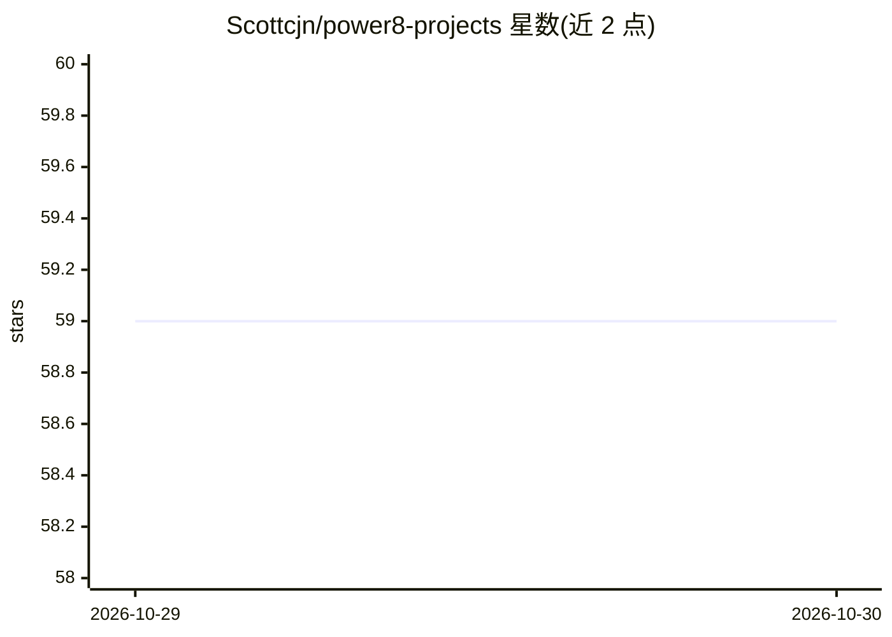

# Scottcjn/power8-projects

⭐ 59 · Shell · Apache-2.0 · 推送 2026-08-06 · [GitHub](https://github.com/Scottcjn/power8-projects) · [官网](https://rustchain.org) · 个人维护

**面向 POWER8 等 CPU 的多架构 Linux 发行版，预装 AI 推理工具**

PowerElyan Linux 是一个多架构 Linux 发行版，声称针对 AI 推理、加密货币挖矿和特定硬件优化。当前仅 ppc64le 架构提供 ISO（Server/Workstation/Full/Miner 四个版本，x86_64 与 aarch64 标注为 Soon），通过 HTTP 链接下载 ISO 并写入 USB 安装。预装带 PSE 优化的 llama.cpp、RustChain 挖矿节点（Miner 版）、Docker 与开发工具链，并附带面向 Darwin (PPC/x86_64/arm64) 的交叉编译器。PSE（Probabilistic Sequence Evolution）部分列出 NUMA 感知权重缓存、L2/L3 常驻预取等特性。由 Elyan Labs 维护。

## 筛选速览

| 维度 | 判定 | 备注 |
|---|---|---|
| AI 角色 | `ai-ecosystem` | LLM/agent 周边工具 |
| 许可风险 | `permissive` | Apache-2.0 |
| 部署形态 | `None` |  |
| 模型依赖 | — | README 未给出锁定关系 |
| 硬件要求 | — | 无带数字的原话,不猜 |
| 安装摩擦 | `high` | 编译与系统依赖俱全 |
| 成熟度 | — | 结构信号不足 |

## 能力要点

- 预装带 PSE 优化的 llama.cpp
- 四个版本（Server/Workstation/Full/Miner），ISO 下载安装
- 附 Darwin PPC/x86_64/arm64 交叉编译工具链
- 声称 NUMA 感知权重缓存与 L2/L3 常驻预取等优化

## 适用场景

- 在 POWER8/ppc64le 硬件上运行本地 LLM 推理
- 搭建无头服务器或容器化工作负载环境
- 运行 RustChain 挖矿节点（Miner 版）

## 场景标签

 · 领域:操作系统/本地 AI 推理

## 证据(README 行号)

> L13: A multi-architecture Linux distribution optimized for AI inference, cryptocurrency mining, and exotic hardware.
> L44: - llama.cpp with PSE optimizations

## 星数曲线

2026-10-29 59 → 2026-10-30 59（+0）

---
*卡片 v1 · prompt 1.4 · 生成 2026-10-28 · 置信度 mid · 依据 README sha `2362da16da9b` · [字段定义](../../DATASET.md)*
