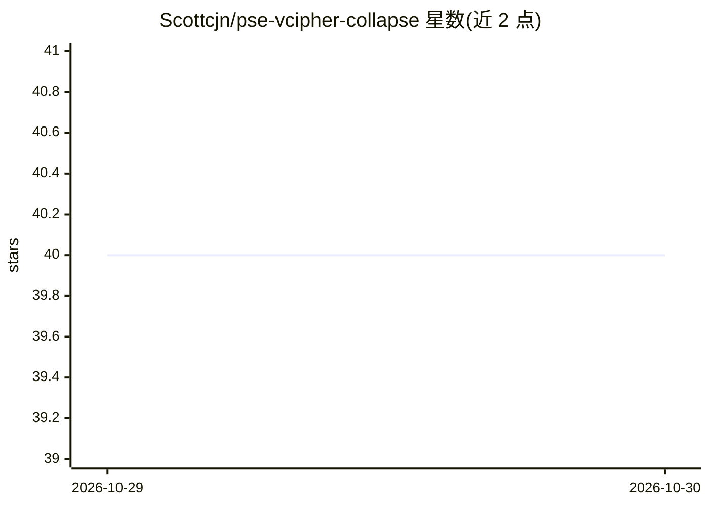

# Scottcjn/pse-vcipher-collapse

⭐ 40 · C · AGPL-3.0 · 推送 2026-08-06 · [GitHub](https://github.com/Scottcjn/pse-vcipher-collapse) · 个人维护

**POWER8 硬件 AES 注意力预筛选原型：加速 llama.cpp CPU 推理**

面向 IBM POWER8 的 LLM 推理内核原型：以 ISA 2.07 AES 指令 vcipher 作为 O(1) 注意力预筛选器、AltiVec vec_perm 实现选择性路径收缩（Hebbian 式 Top-K 剪枝/增强），通过补丁 ggml flash-attn 内循环，使完整 Q·K 只对约前 25% 的 K-V 对计算。在 S824（512GB RAM、128 线程）上报告 TinyLlama pp128 147.54 t/s（自称较 stock llama.cpp 8.81 倍）。注入 mftb 硬件时基熵，导致同种子同提示每次输出不同。限 POWER8 平台，需头文件放入 llama.cpp 源码树编译。

## 筛选速览

| 维度 | 判定 | 备注 |
|---|---|---|
| AI 角色 | `ai-ecosystem` | LLM/agent 周边工具 |
| 许可风险 | `viral` | AGPL-3.0 |
| 部署形态 | `None` |  |
| 模型依赖 | — | README 未给出锁定关系 |
| 硬件要求 | `cpu-ok` | |
| 安装摩擦 | `medium` | 含编译或系统依赖之一 |
| 成熟度 | `idea` | |

## 能力要点

- vcipher O(1) 预筛选 + vec_perm 路径收缩替代全矩阵点积
- Flash Attention 内循环补丁，仅对前 25% K-V 对做完整计算
- DCBT 驻留预取与 VSX 12 路收缩头文件集
- mftb 硬件熵注入产生运行间行为分歧

## 适用场景

- 在 POWER8 服务器上加速 llama.cpp CPU 推理
- 研究以 AES 指令实现非线性注意力预筛选
- 为大模型在非 GPU 硬件上部署提供内核优化参考

## 场景标签

`推理引擎` · 领域:训练与推理

## 证据(README 行号)

> L5: > **Answer-first:** PSE vcipher collapse is a POWER8-oriented LLM inference prototype that explores selective attent
> L94: The vcipher prefilter patches `ggml_compute_forward_flash_attn_ext_f16_one_chunk()` in llama.cpp:
> L177: cd llama.cpp && mkdir build-vcipher && cd build-vcipher

## 星数曲线

2026-10-29 40 → 2026-10-30 40（+0）

---
*卡片 v1 · prompt 1.4 · 生成 2026-10-28 · 置信度 high · 依据 README sha `3d16b7c5d01a` · [字段定义](../../DATASET.md)*
