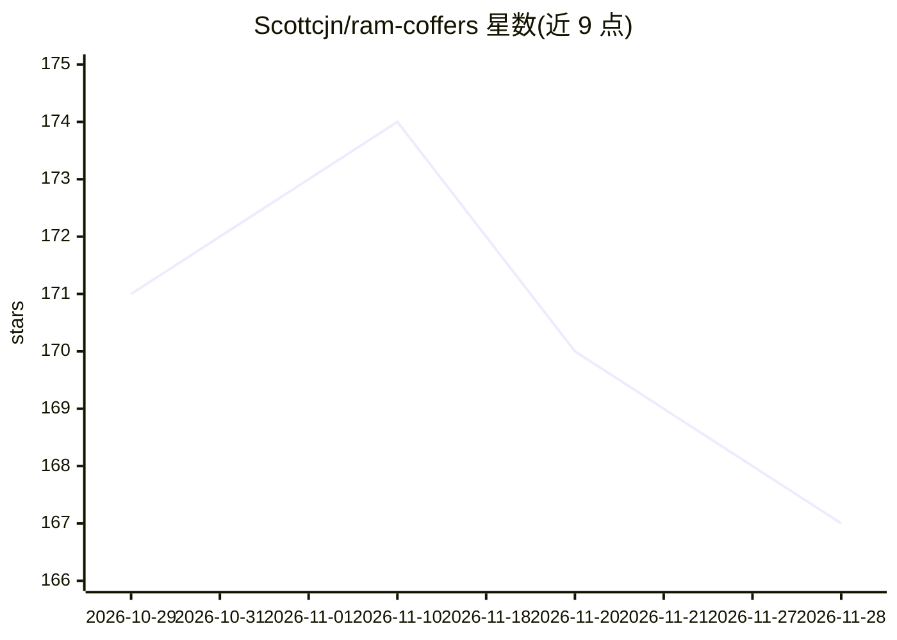

# Scottcjn/ram-coffers

⭐ 167 · Python · AGPL-3.0 · 推送 2026-11-23 · [GitHub](https://github.com/Scottcjn/ram-coffers) · [官网](https://rustchain.org) · 个人维护

**面向自托管推理的 NUMA 内存分库路由：在二手 POWER8 上跑 LLM**

RAM Coffers 是一套针对 llama.cpp/GGML 推理路径的 NUMA 感知内存路由架构：将模型权重按领域分区到多个 RAM bank（coffer），查询经嵌入与余弦相似度选择目标 coffer，再做非双射剪枝与 PowerPC DCBT 缓存预取，宣称在 IBM POWER8 S824 上达到 147 tokens/sec。代码为 C 头文件与 Flash Attention 补丁，需在 POWER8 上用 cmake 编译；非 POWER8/单 NUMA 系统行为见 FALLBACK_BEHAVIOR.md。项目同时与 RustChain 'Proof of Physical AI' 挖矿生态绑定。

## 筛选速览

| 维度 | 判定 | 备注 |
|---|---|---|
| AI 角色 | `ai-ecosystem` | LLM/agent 周边工具 |
| 许可风险 | `viral` | AGPL-3.0 |
| 部署形态 | `None` |  |
| 模型依赖 | local-ok | 支持本地模型 |
| 硬件要求 | `cpu-ok` | |
| 安装摩擦 | `medium` | 含编译或系统依赖之一 |
| 成熟度 | `idea` | |

## 能力要点

- NUMA 权重分库 + 余弦相似度共振路由（O(1) 知识检索路径）
- vcipher 硬件 AES 指令复用为注意力坍缩算子（4 种运行模式）
- GGUF 模型跨 NUMA 节点 mmap 分片
- 提供 6 篇 Zenodo DOI 论文与 BENCHMARK.md 复现说明

## 适用场景

- 在无 GPU 的二手企业级 POWER8 服务器上自托管 LLM 推理
- 研究 NUMA 拓扑与缓存预取对推理吞吐的影响
- 复现/审计其基准数据（BENCHMARK.md 提供命令）

## 场景标签

`推理引擎` · 领域:训练与推理

## 证据(README 行号)

> L3: RAM Coffers is LLM infrastructure for inference cost reduction: a NUMA-aware conditional memory architecture that ro
> L36: This work introduces **RAM Coffers**, a NUMA-aware conditional memory architecture for efficient Large Language Mod
> L141: **Running on non-POWER8 or single-NUMA systems?** See FALLBACK_BEHAVIOR.md for details on what works, what doesn't

## 星数曲线

2026-10-29 171 → 2026-11-28 167（-4）

---
*卡片 v1 · prompt 1.4 · 生成 2026-11-26 · 置信度 mid · 依据 README sha `08908823bdb7` · [字段定义](../../DATASET.md)*
