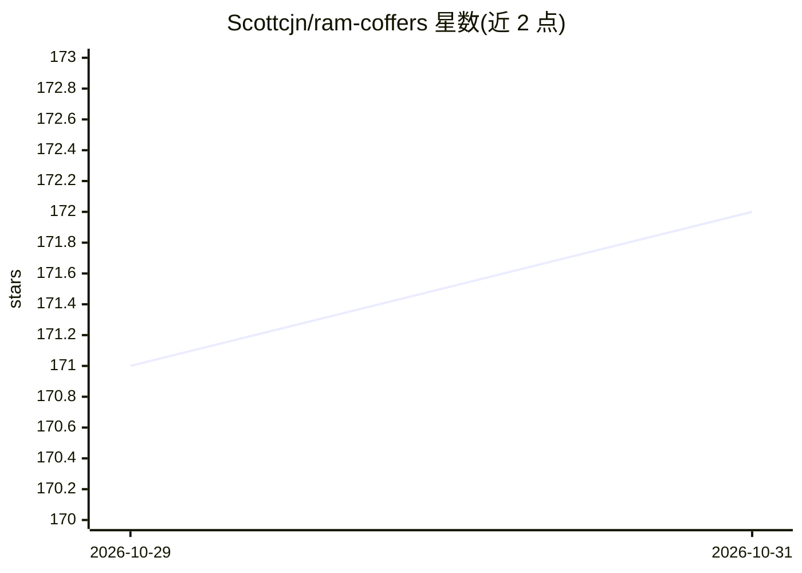

# Scottcjn/ram-coffers

⭐ 172 · Python · AGPL-3.0 · 推送 2026-09-27 · [GitHub](https://github.com/Scottcjn/ram-coffers) · [官网](https://rustchain.org) · 个人维护

**基于 NUMA 内存分柜的 LLM 推理优化架构，面向自托管旧硬件**

RAM Coffers 是一套 C 头文件形式的 NUMA 感知条件内存架构：将模型权重按领域分片到多个 NUMA 内存柜，用余弦相似度的共振路由选择柜体，配合非双射路径裁剪、DCBT 预取与 POWER8 硬件 AES（vcipher）注意力预过滤，降低全量权重访问。基准为 IBM POWER8 S824 上 147 tokens/sec。属 RustChain Proof of Physical AI 生态。限制：实测硬件为 POWER8，非 POWER8/单 NUMA 系统需查 FALLBACK_BEHAVIOR.md；BENCHMARK.md 自述部分内容尚未复现。提供 cmake 编译方式，无预编译安装包。

## 筛选速览

| 维度 | 判定 | 备注 |
|---|---|---|
| AI 角色 | `ai-ecosystem` | LLM/agent 周边工具 |
| 许可风险 | `viral` | AGPL-3.0 |
| 部署形态 | `None` |  |
| 模型依赖 | — | README 未给出锁定关系 |
| 硬件要求 | `cpu-ok` | |
| 安装摩擦 | `medium` | 含编译或系统依赖之一 |
| 成熟度 | `idea` | |

## 能力要点

- NUMA 分布式权重分柜 + 余弦相似度共振路由
- vcipher 硬件 AES 注意力预过滤（两段式 Flash Attention 路径）
- POWER8 S824 实测 147 tokens/sec
- 附 Apple Silicon 移植与 PS5/Xbox 主机集群方案（gen9-cluster）

## 适用场景

- 在翻新企业 POWER8 服务器上自托管运行 LLM 推理
- 将旧硬件接入 Proof of Physical AI 生态并参与 RTC 挖矿
- 研究 CPU-only/无 GPU 环境下的注意力裁剪与 NUMA 路由技术

## 场景标签

`推理引擎` · 领域:训练与推理

## 证据(README 行号)

> L3: RAM Coffers is LLM infrastructure for inference cost reduction: a NUMA-aware conditional memory architecture that ro
> L35: This work introduces **RAM Coffers**, a NUMA-aware conditional memory architecture for efficient Large Language Mod
> L185: |`ggml-coffer-mmap.h`|GGUF model sharding across NUMA nodes|

## 星数曲线

2026-10-29 171 → 2026-10-31 172（+1）

---
*卡片 v1 · prompt 1.4 · 生成 2026-10-28 · 置信度 mid · 依据 README sha `c9636ba34a4b` · [字段定义](../../DATASET.md)*
