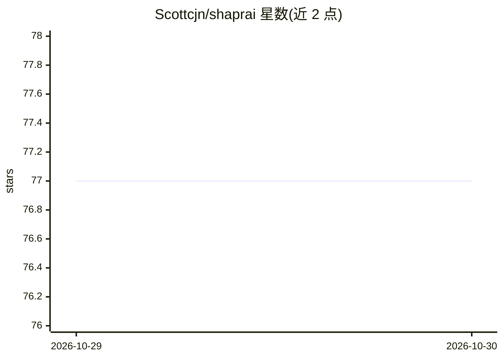

# Scottcjn/shaprai

⭐ 77 · Python · MIT · 推送 2026-09-26 · [GitHub](https://github.com/Scottcjn/shaprai) · 组织维护

**Agent 生命周期管理平台：将原始模型训练并约束为可治理 agent**

Elyan Labs 开源的 agent 生命周期管理平台：从模板创建 agent，经 QLoRA SFT 与 DPO/KTO/ORPO/SimPO 偏好优化训练，再通过 Sanctuary 教育程序（阈值 0.85 毕业考核）后部署到 GitHub 等平台。内含 DriftLock 多轮对抗评估（测身份漂移与立场回退）、MCP/A2A 服务暴露、舰队状态管理，以及与 RustChain/Beacon/BoTTube/Grazer 的生态集成。训练语料需另行安装或从 teacher 模型合成。以 pip 包与 CLI 提供，Python 3.10-3.14。

## 筛选速览

| 维度 | 判定 | 备注 |
|---|---|---|
| AI 角色 | `ai-ecosystem` | LLM/agent 周边工具 |
| 许可风险 | `permissive` | MIT |
| 部署形态 | `library` | 以包/库形式分发 |
| 模型依赖 | — | README 未给出锁定关系 |
| 硬件要求 | — | 无带数字的原话,不猜 |
| 安装摩擦 | `low` | 无编译、无系统依赖或容器化 |
| 成熟度 | — | 结构信号不足 |

## 能力要点

- CREATE→TRAINING→SANCTUARY→GRADUATED→DEPLOYED 全生命周期 CLI
- QLoRA SFT 加 DPO/KTO/ORPO/SimPO 偏好优化，训练栈为可选 extras
- DriftLock 对抗式多轮对话评估身份漂移与立场回退
- agent 可经 MCP（stdio/streamable-http）服务化并发布 A2A Agent Card

## 适用场景

- 我用它从模板创建并微调定制 AI agent
- 对 agent 做毕业考核式评估后再部署
- 把训练好的 agent 以 MCP/A2A 协议暴露给其他客户端

## 场景标签

`Agent 框架` `微调` `模型评测` · 领域:Agent 开发

## 证据(README 行号)

> L9: ShaprAI is an open-source agent lifecycle management platform. It takes raw
> L106: CREATE -> TRAINING (SFT -> DPO/KTO/ORPO/SimPO -> DriftLock) -> SANCTUARY -> GRADUATED -> DEPLOYED
> L205: pip install 'shaprai[mcp]'

## 星数曲线

2026-10-29 77 → 2026-10-30 77（+0）

---
*卡片 v1 · prompt 1.4 · 生成 2026-10-28 · 置信度 high · 依据 README sha `d0b719aa2e68` · [字段定义](../../DATASET.md)*
