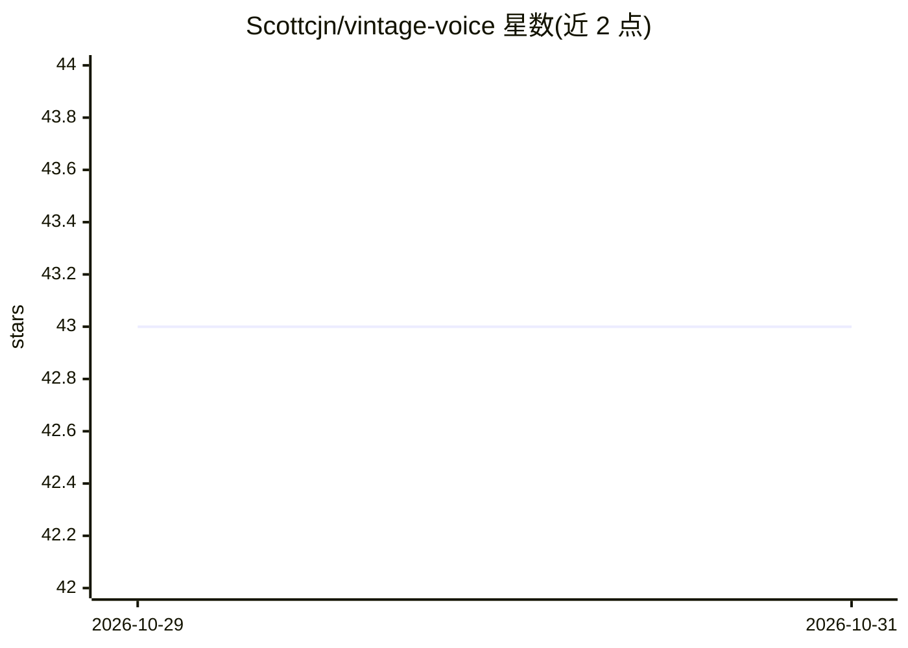

# Scottcjn/vintage-voice

⭐ 43 · Python · MIT · 推送 2026-08-06 · [GitHub](https://github.com/Scottcjn/vintage-voice) · 个人维护

**复刻历史语音风格的开源 TTS 微调模型（跨大西洋腔等）**

基于 SWivid/F5-TTS（F5TTS_v1_Base，337M 参数）的文本转语音微调模型，使用 Archive.org 等来源的 164 小时 1955 年前公有领域音频训练（50 epochs、990,100 updates）。用户以参考音频提供说话人音色，模型迁移 1920s-1960s 时期的跨大西洋节奏、新闻片播报等风格，不克隆特定历史人物。v0.1.0 仅验证 transatlantic 预设；约 24% 训练片段存在标注噪声。运行方式为安装 F5-TTS 推理引擎后调用脚本或 API。

## 筛选速览

| 维度 | 判定 | 备注 |
|---|---|---|
| AI 角色 | `ai-native` | 本体是模型或模型工具 |
| 许可风险 | `permissive` | MIT |
| 部署形态 | `library` | 以包/库形式分发 |
| 模型依赖 | — | README 未给出锁定关系 |
| 硬件要求 | — | 无带数字的原话,不猜 |
| 安装摩擦 | `medium` | 含编译或系统依赖之一 |
| 成熟度 | `idea` | |

## 能力要点

- 164 小时 1955 年前公有领域音频训练的 F5-TTS 微调
- 风格迁移设计：保留参考音频说话人音色，仅迁移时期语音风格
- 9 个语音预设（仅 transatlantic 已验证，其余待参考剪辑）
- 支持 CPU/Apple Silicon MPS/CUDA 自动设备选择与基准干跑脚本

## 适用场景

- 为影视、播客或游戏生成 1940 年代风格的旁白语音
- 在保留自己音色的前提下获得跨大西洋等历史腔调
- 参与濒危语言（如路易斯安那 Cajun French）的语音保存项目

## 场景标签

`语音合成` `微调` · 领域:内容生成

## 证据(README 行号)

> L25: > **Answer-first:** VintageVoice is an experimental F5-TTS fine-tune for historical speech patterns, trained on pub
> L30: VintageVoice is a fine-tune of F5-TTS (SWivid/F5-TTS)
> L98: 1. **Voice (this model).** A short text prompt is synthesized into a 5-second

## 星数曲线

2026-10-29 43 → 2026-10-31 43（+0）

---
*卡片 v1 · prompt 1.4 · 生成 2026-10-28 · 置信度 high · 依据 README sha `c39f575a20ec` · [字段定义](../../DATASET.md)*
