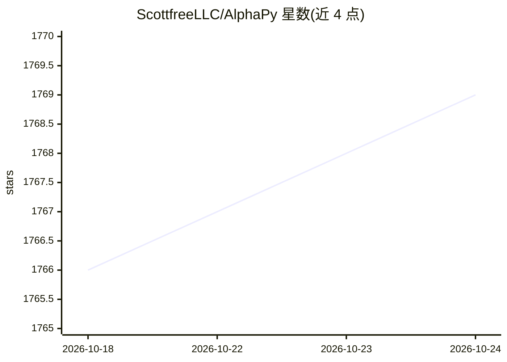

# ScottfreeLLC/AlphaPy

⭐ 1,771 · Python · Apache-2.0 · 推送 2026-10-05 · [GitHub](https://github.com/ScottfreeLLC/AlphaPy) · 个人维护

**面向交易与体育预测的 Python 机器学习框架**

用 Python 编写的机器学习框架，基于 scikit-learn 与 pandas，支持 Keras、XGBoost、LightGBM、CatBoost 等库训练模型，可生成 blended/stacked 集成。面向投机交易者与数据科学家：MarketFlow 子系统用于市场分析、交易系统开发与组合分析（配合 Quantopian 的 pyfolio），SportFlow 用于体育赛事预测。通过 pip 安装，XGBoost/LightGBM/CatBoost 为可选依赖需自行安装。README 声明活跃开发已转移至商业化的 AlphaPy Pro。

## 筛选速览

| 维度 | 判定 | 备注 |
|---|---|---|
| AI 角色 | `ai-native` | 本体是模型或模型工具 |
| 许可风险 | `permissive` | Apache-2.0 |
| 部署形态 | `library` | 以包/库形式分发 |
| 模型依赖 | — | README 未给出锁定关系 |
| 硬件要求 | — | 无带数字的原话,不猜 |
| 安装摩擦 | `low` | 无编译、无系统依赖或容器化 |
| 成熟度 | — | 结构信号不足 |

## 能力要点

- 支持 scikit-learn/Keras/XGBoost/LightGBM/CatBoost 训练模型
- blended 与 stacked 集成生成
- MarketFlow 用于市场分析与交易系统开发
- SportFlow 用于体育赛事预测

## 适用场景

- 开发和回测交易系统并分析投资组合
- 用机器学习预测体育赛事
- 构建与集成多个机器学习模型

## 场景标签

`金融量化` · 领域:学习与行业

## 证据(README 行号)

> L5: **AlphaPy** is a machine learning framework for both speculators and
> L21: * Run machine learning models using ``scikit-learn``, ``Keras``, ``xgboost``, ``LightGBM``, and ``CatBoost``.

## 星数曲线

2026-10-18 1,766 → 2026-10-24 1,769（+3）

---
*卡片 v1 · prompt 1.4 · 生成 2026-10-21 · 置信度 high · 依据 README sha `0f3db77a678e` · [字段定义](../../DATASET.md)*
