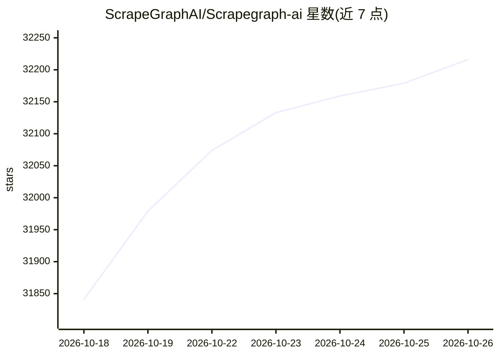

# ScrapeGraphAI/Scrapegraph-ai

⭐ 32,216 · Python · MIT · 推送 2026-10-06 · [GitHub](https://github.com/ScrapeGraphAI/Scrapegraph-ai) · [官网](https://scrapegraphai.com) · 组织维护

**基于 LLM 的 Python 网页抓取库，自然语言即抽取**

使用 LLM 与图（graph）逻辑构建抓取流水线的 Python 库，支持网站与本地文档（XML、HTML、JSON、Markdown）的信息抽取，用户给出提示词与来源即可输出结构化字典。内置 SmartScraperGraph、SearchGraph、SpeechGraph、ScriptCreatorGraph 等多种流水线及多页并行版本，可通过 OpenAI、Groq、Azure、Gemini、MiniMax 等 API 或 Ollama 本地模型调用 LLM。安装需配合 Playwright，另有官方托管云 API（Python/Node SDK）与匿名遥测（可关闭）。

## 筛选速览

| 维度 | 判定 | 备注 |
|---|---|---|
| AI 角色 | `ai-native` | 本体是模型或模型工具 |
| 许可风险 | `permissive` | MIT |
| 部署形态 | `library` | 以包/库形式分发 |
| 模型依赖 | local-ok | 支持本地模型 |
| 硬件要求 | — | 无带数字的原话,不猜 |
| 安装摩擦 | `low` | 无编译、无系统依赖或容器化 |
| 成熟度 | — | 结构信号不足 |

## 动量与使用信号

- 维护:`active` — 距上次 push 12.0 天,年发版 50,122 位贡献者
- 涨星:近 1 天 **+38**(自 20261016 起算)
- 安装:pypi 包 `scrapegraphai` 月下载 32,537
- 平台:— · 协议:MCP / OLLAMA

## 能力要点

- 提示词驱动的抓取流水线（SmartScraperGraph 等 6 种及 multi 并行版本）
- 支持 OpenAI/Groq/Azure/Gemini/MiniMax 等 API 与 Ollama 本地模型
- 可抓取网站与本地文档（XML/HTML/JSON/Markdown），并可生成 Python 脚本或音频文件
- 同时提供开源库与托管云 API 两种形态（MIT 许可）

## 适用场景

- 给定 URL 和提示词，抽取单页或多页的结构化信息
- 结合搜索引擎结果做多页信息聚合
- 用本地 Ollama 模型在自有环境运行抽取流程
- 让库生成 Python 抓取脚本供后续复用

## 场景标签

`网页抓取` · 领域:效率与自动化

## 证据(README 行号)

> L24: ScrapeGraphAI is a *web scraping* python library that uses LLM and direct graph logic to create scraping pipelines 
> L103: It is possible to use different LLM through APIs, such as **OpenAI**, **Groq**, **Azure**, **Gemini**, **MiniMax**

## 星数曲线

2026-10-18 31,841 → 2026-10-26 32,216（+375）

---
*卡片 v1 · prompt 1.4 · 生成 2026-10-18 · 置信度 high · 依据 README sha `db32b2f48f69` · [字段定义](../../DATASET.md)*
