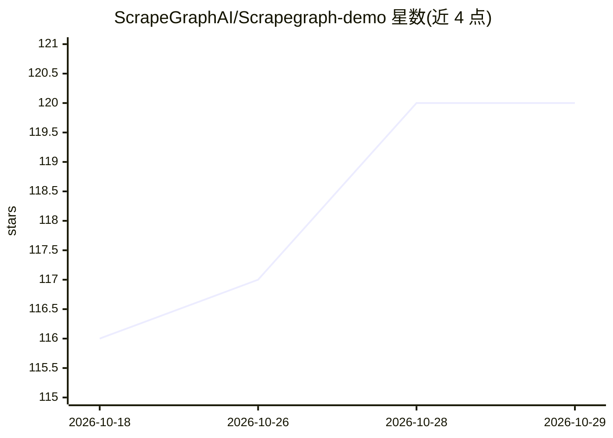

# ScrapeGraphAI/Scrapegraph-demo

⭐ 120 · Python · MIT · 推送 2026-10-27 · [GitHub](https://github.com/ScrapeGraphAI/Scrapegraph-demo) · [官网](https://scrapegraph-ai-demo.streamlit.app/) · 组织维护

**ScrapeGraphAI 官方 SDK 的 Streamlit 演示应用**

基于 Streamlit 的演示工程，通过官方 scrapegraph-py SDK 调用 ScrapeGraphAI API，展示三项服务：Extract（用自然语言提示从 URL 提取 AI 结构化数据，可选 JSON schema）、Scrape（输出页面 markdown/html/links/images/summary）、Search（搜索网页并可选提取结构化数据）。需从 dashboard 获取 API key 粘贴到应用后运行。本地用 streamlit run main.py 启动，另附独立 SDK 示例脚本。库本体基于 LangChain，使用 LLM 与直接图逻辑构建抓取管道。

## 筛选速览

| 维度 | 判定 | 备注 |
|---|---|---|
| AI 角色 | `ai-native` | 本体是模型或模型工具 |
| 许可风险 | `permissive` | MIT |
| 部署形态 | `None` |  |
| 模型依赖 | — | README 未给出锁定关系 |
| 硬件要求 | — | 无带数字的原话,不猜 |
| 安装摩擦 | `low` | 无编译、无系统依赖或容器化 |
| 成熟度 | — | 结构信号不足 |

## 能力要点

- Extract/Scrape/Search 三项 API 服务的界面演示
- 自然语言提示驱动网页结构化数据提取（可选 JSON schema）
- 附 scrapegraph_py_example.py 最小独立 SDK 脚本
- 本地以 streamlit run main.py 运行

## 适用场景

- 试用 ScrapeGraphAI API 的提取/抓取/搜索能力
- 参考 SDK 调用方式接入自己的抓取项目
- 用自然语言从网页提取结构化数据

## 场景标签

`网页抓取` · 领域:效率与自动化

## 证据(README 行号)

> L20: This repo is a Streamlit demo for the official `scrapegraph-py` SDK.
> L23: - **Extract** — AI-structured data from a URL via a natural-language prompt (with an optional JSON schema)

## 星数曲线

2026-10-18 116 → 2026-10-29 120（+4）

---
*卡片 v1 · prompt 1.4 · 生成 2026-10-23 · 置信度 high · 依据 README sha `aa75985b7992` · [字段定义](../../DATASET.md)*
