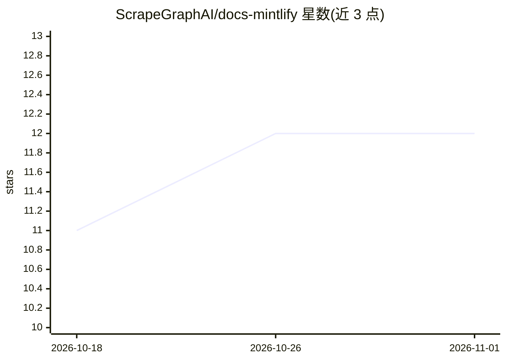

# ScrapeGraphAI/docs-mintlify

⭐ 12 · MDX · MIT · 推送 2026-09-15 · [GitHub](https://github.com/ScrapeGraphAI/docs-mintlify) · [官网](https://docs.scrapegraphai.com) · 组织维护

**ScrapeGraphAPI 官方文档仓库（Mintlify/MDX 构建）**

存放 ScrapeGraphAPI（一套 AI 驱动的网页抓取工具套件）的官方文档，使用 Mintlify 框架与 MDX 编写，包含介绍页、核心服务文档与导航配置。本地预览需先全局安装 Mintlify CLI（npm i -g mintlify），再运行 mintlify dev 启动开发服务器（localhost:3000）。仓库以 MIT 许可发布，接受社区通过 fork/PR 贡献文档，并要求改动前本地测试、更新 mint.json 导航。

## 筛选速览

| 维度 | 判定 | 备注 |
|---|---|---|
| AI 角色 | `ai-knowledge` | 知识聚合/清单类 |
| 许可风险 | `permissive` | MIT |
| 部署形态 | `library` | 以包/库形式分发 |
| 模型依赖 | — | README 未给出锁定关系 |
| 硬件要求 | — | 无带数字的原话,不猜 |
| 安装摩擦 | `low` | 无编译、无系统依赖或容器化 |
| 成熟度 | — | 结构信号不足 |

## 能力要点

- 基于 Mintlify 与 MDX 的文档站，含 React 交互组件
- 提供本地预览流程：npm 安装 Mintlify CLI 后运行 mintlify dev
- 文档结构与贡献流程有明确定义（含 mint.json 导航更新要求）

## 适用场景

- 查阅 ScrapeGraphAPI 的功能与服务文档
- 为 ScrapeGraphAPI 文档贡献修改或新增页面
- 本地运行文档站预览改动

## 场景标签

 · 领域:开发文档/网页抓取工具

## 证据(README 行号)

> L9: This repository contains the official documentation for ScrapeGraphAPI, a suite of AI-powered web scraping tools. Ou
> L62: - **Mintlify**: Documentation framework

## 星数曲线

2026-10-18 11 → 2026-11-01 12（+1）

---
*卡片 v1 · prompt 1.4 · 生成 2026-11-01 · 置信度 mid · 依据 README sha `7fc03fc14d54` · [字段定义](../../DATASET.md)*
