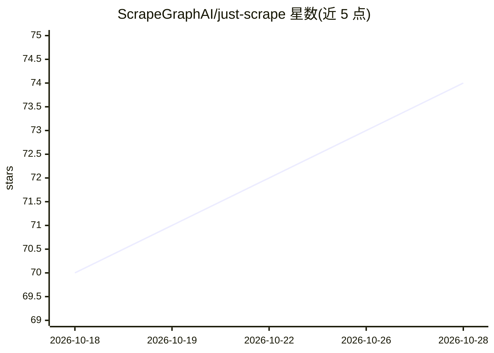

# ScrapeGraphAI/just-scrape

⭐ 74 · TypeScript · MIT · 推送 2026-09-21 · [GitHub](https://github.com/ScrapeGraphAI/just-scrape) · [官网](https://scrapegraphai.com) · 组织维护

**ScrapeGraphAI 的 CLI：网页抓取、结构化提取与监控**

ScrapeGraphAI 官方命令行工具，封装 ScrapeGraph AI API 工作流：将已知 URL 转为 markdown/HTML/截图/链接/图片/摘要/品牌信息，或按提示词加 JSON Schema 提取结构化数据；支持网页搜索、限定范围的多页爬取、定时页面变更监控（可选 webhook 通知），以及额度校验等运营命令。需 Node.js>=22 与 ScrapeGraph API key，通过 npm 全局安装或 npx 直接运行，另提供可安装到编码代理的 SKILL.md 技能。

## 筛选速览

| 维度 | 判定 | 备注 |
|---|---|---|
| AI 角色 | `ai-ecosystem` | LLM/agent 周边工具 |
| 许可风险 | `permissive` | MIT |
| 部署形态 | `library` | 以包/库形式分发 |
| 模型依赖 | — | README 未给出锁定关系 |
| 硬件要求 | — | 无带数字的原话,不猜 |
| 安装摩擦 | `low` | 无编译、无系统依赖或容器化 |
| 成熟度 | — | 结构信号不足 |

## 能力要点

- scrape/extract/search/crawl/monitor 五类命令覆盖抓取到监控工作流
- prompt + JSON Schema 输出结构化 JSON
- 定时页面变更监控与 webhook 通知
- 提供编码代理技能（SKILL.md）与 --json 管道输出

## 适用场景

- 把任意网页快速转成 markdown 供脚本或代理消费
- 从商品页等已知 URL 按提示词提取结构化字段
- 定时监控页面价格或内容变化并接收通知

## 场景标签

`网页抓取` · 领域:效率与自动化

## 证据(README 行号)

> L5: Command-line interface for ScrapeGraphAI. This repo contains the CLI source, command modules, build setup, smoke tes
> L9: `just-scrape` wraps ScrapeGraphAI workflows behind a small terminal interface:
> L28: - ScrapeGraph client: `scrapegraph-js`

## 星数曲线

2026-10-18 70 → 2026-10-28 74（+4）

---
*卡片 v1 · prompt 1.4 · 生成 2026-10-24 · 置信度 high · 依据 README sha `03ea4d31fb0e` · [字段定义](../../DATASET.md)*
