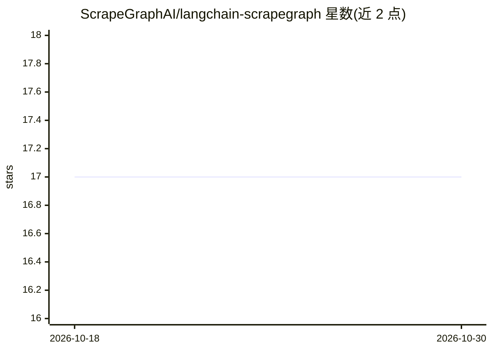

# ScrapeGraphAI/langchain-scrapegraph

⭐ 17 · Python · MIT · 推送 2026-04-18 · [GitHub](https://github.com/ScrapeGraphAI/langchain-scrapegraph) · [官网](https://scrapegraphai.com) · 组织维护

**为 LangChain agent 提供 ScrapeGraph AI 网页抓取工具的集成库**

Python 包 langchain-scrapegraph，将 ScrapeGraph AI 的能力封装为 LangChain 工具：MarkdownifyTool 将网页转为 Markdown，SmartScraperTool 用自然语言提示从网页提取结构化数据，SearchScraperTool 从网络搜索并提取结构化信息，输出可用 Pydantic 模型定义结构，支持异步操作。工具调用 ScrapeGraph 云 API，需设置 SGAI_API_KEY 环境变量。面向构建研究、数据采集类 agent 的开发者，需配合 LangChain agent 框架使用。

## 筛选速览

| 维度 | 判定 | 备注 |
|---|---|---|
| AI 角色 | `ai-ecosystem` | LLM/agent 周边工具 |
| 许可风险 | `permissive` | MIT |
| 部署形态 | `library` | 以包/库形式分发 |
| 模型依赖 | — | README 未给出锁定关系 |
| 硬件要求 | — | 无带数字的原话,不猜 |
| 安装摩擦 | `low` | 无编译、无系统依赖或容器化 |
| 成熟度 | — | 结构信号不足 |

## 能力要点

- 提供 MarkdownifyTool / SmartScraperTool / SearchScraperTool 三个 LangChain 工具
- 自然语言提示提取结构化数据，支持 Pydantic 输出 schema
- 内置异步操作支持
- 依赖 ScrapeGraph API key（SGAI_API_KEY）

## 适用场景

- 让 LangChain agent 用自然语言从网页提取结构化数据
- 将网页内容转为 Markdown 供 agent 进一步处理
- 构建自动采集并分析网络数据的研究型 agent

## 场景标签

`网页抓取` · 领域:效率与自动化

## 证据(README 行号)

> L7: Supercharge your LangChain agents with AI-powered web scraping capabilities. LangChain-ScrapeGraph provides a seamle
> L62: ### 📝 MarkdownifyTool
> L74: ### 🔍 SmartscraperTool
> L84: ### 🌐 SearchscraperTool

## 星数曲线

2026-10-18 17 → 2026-10-30 17（+0）

---
*卡片 v1 · prompt 1.4 · 生成 2026-10-29 · 置信度 high · 依据 README sha `a3b26abb9811` · [字段定义](../../DATASET.md)*
