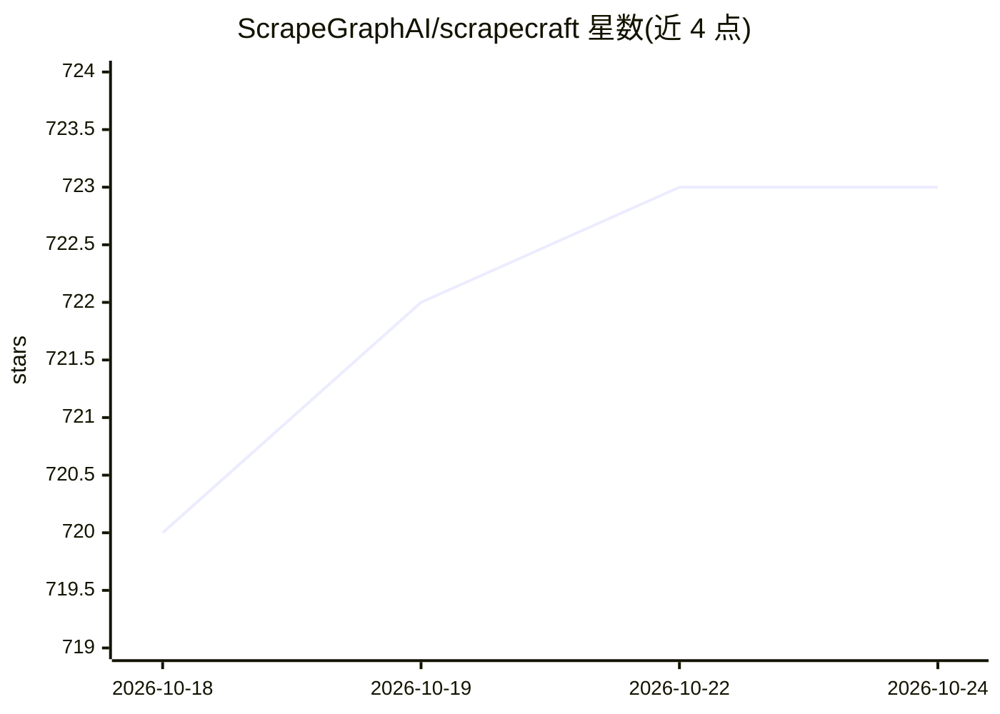

# ScrapeGraphAI/scrapecraft

⭐ 723 · Python · MIT · 推送 2025-12-26 · [GitHub](https://github.com/ScrapeGraphAI/scrapecraft) · 组织维护

**面向网页抓取的 AI 编辑器：自然语言构建抓取流水线**

基于 Web 的抓取流水线编辑器，定位为‘专用于网页抓取的 Cursor 类工具’。用户添加目标 URL、用 Pydantic 定义数据模式，由 AI 助手（OpenRouter 接入的 Kimi-k2 模型）生成带异步支持的 Python 抓取代码，通过 ScrapeGraphAI API 执行抓取，结果以表格/JSON 展示并可导出。后端为 FastAPI + LangGraph，前端 React/TypeScript，依赖 PostgreSQL 与 Redis，以 Docker Compose 一键部署，Watchtower 支持自动更新。需自备 OpenRouter 与 ScrapeGraphAI 两把 API key。

## 筛选速览

| 维度 | 判定 | 备注 |
|---|---|---|
| AI 角色 | `ai-native` | 本体是模型或模型工具 |
| 许可风险 | `permissive` | MIT |
| 部署形态 | `self-host` | docker 或自建部署 |
| 模型依赖 | locked-api |  |
| 硬件要求 | — | 无带数字的原话,不猜 |
| 安装摩擦 | `low` | 无编译、无系统依赖或容器化 |
| 成熟度 | — | 结构信号不足 |

## 能力要点

- 自然语言生成异步 Python 抓取代码
- 多 URL 批量抓取与 Pydantic 动态模式定义
- WebSocket 实时流式输出，结果表格/JSON 展示并导出
- Docker Compose 一键部署，Watchtower 自动更新容器

## 适用场景

- 用对话方式快速搭建并测试网站数据抓取流水线
- 批量抓取多个页面的结构化数据并导出 JSON/CSV
- 自托管一个带 AI 助手的抓取开发环境

## 场景标签

`网页抓取` `代码生成` · 领域:效率与自动化

## 证据(README 行号)

> L3: ScrapeCraft is a web-based scraping editor similar to Cursor but specialized for web scraping. It uses AI assistance
> L10: - 🤖 AI-powered assistant using OpenRouter (Kimi-k2 model)
> L87: 4. **Generate Code**: Ask the AI to generate scraping code

## 星数曲线

2026-10-18 720 → 2026-10-24 723（+3）

---
*卡片 v1 · prompt 1.4 · 生成 2026-10-21 · 置信度 mid · 依据 README sha `a8caaf11d5f2` · [字段定义](../../DATASET.md)*
