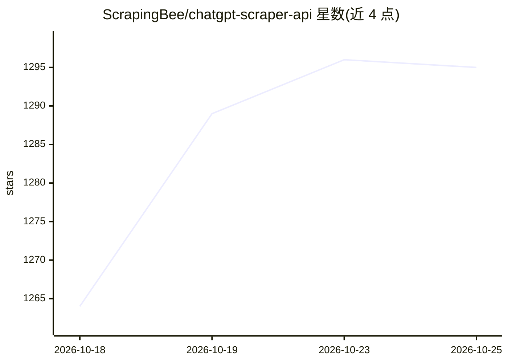

# ScrapingBee/chatgpt-scraper-api

⭐ 1,295 · 推送 2026-07-15 · [GitHub](https://github.com/ScrapingBee/chatgpt-scraper-api) · [官网](https://www.scrapingbee.com/features/chatgpt/) · 组织维护

**ScrapingBee ChatGPT 抓取 API 的示例与接入指南仓库**

ScrapingBee 官方仓库，演示如何通过单一 API（chatGPT 端点）构建 ChatGPT 抓取工作流：以自然语言 prompt 描述所需数据，可选启用实时网页搜索、地理定向（country_code）与目标页 HTML 注入（add_html），由 LLM 处理后返回结构化 JSON。提供 npm SDK（Node.js）与 Python requests 两种调用示例及错误码、重试建议。需注意本仓库为付费商业 API 的使用示范，非独立可运行的抓取工具，运行需 API key。

## 筛选速览

| 维度 | 判定 | 备注 |
|---|---|---|
| AI 角色 | `ai-native` | 本体是模型或模型工具 |
| 许可风险 | `none` | — |
| 部署形态 | `library` | 以包/库形式分发 |
| 模型依赖 | — | README 未给出锁定关系 |
| 硬件要求 | — | 无带数字的原话,不猜 |
| 安装摩擦 | `low` | 无编译、无系统依赖或容器化 |
| 成熟度 | — | 结构信号不足 |

## 能力要点

- 自然语言 prompt 定义抓取目标，替代选择器解析逻辑
- 可选实时搜索、地理定向与 HTML 上下文注入
- 返回结构化 JSON（如商品名/价格/库存字段）
- 提供 Node.js SDK 与 Python 两种调用示例

## 适用场景

- 抓取布局频繁变动网站上的结构化商品数据
- 结合实时搜索做竞品研究与新闻监测
- 区域定向的价格与本地 SEO 数据提取

## 场景标签

`网页抓取` · 领域:效率与自动化

## 证据(README 行号)

> L7: A production-ready ChatGPT scraper for intelligent web search, contextual extraction, and AI-powered website scrapin
> L80:     const response = await client.chatGPT({
> L173: url = "https://app.scrapingbee.com/api/v1/chatgpt"

## 星数曲线

2026-10-18 1,264 → 2026-10-25 1,295（+31）

---
*卡片 v1 · prompt 1.4 · 生成 2026-10-21 · 置信度 high · 依据 README sha `913abadc4024` · [字段定义](../../DATASET.md)*
