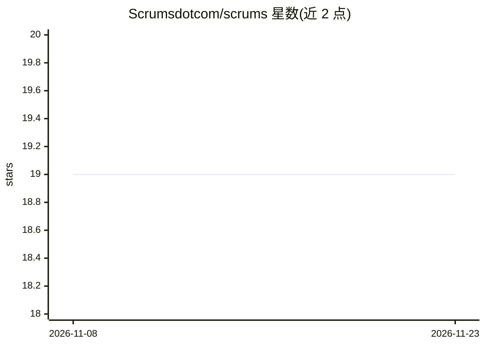

# Scrumsdotcom/scrums

⭐ 19 · TypeScript · Apache-2.0 · 推送 2026-11-22 · [GitHub](https://github.com/Scrumsdotcom/scrums) · [官网](https://www.scrums.com) · 组织维护

**企业软件工程 AI 平台的文档与开源组件仓库**

Scrums.com 定位为企业软件工程 AI 平台，工程负责人可从统一目录部署 AI agent、模型、AI 工程师与基础设施，并在单一控制平面（SEOP 架构）上治理和度量。本仓库收录：Mintlify 构建的官方文档源码、Sorted UI React 组件与设计 tokens、实验性 agent 执行语言 NextType（含 ntc 检查器与 nt 预览 CLI）、Company-as-Code 操作系统的固定副本，以及面向零数据保留 LLM 的数据净化指南与五个开源净化工具。每月 1 日发布版本。平台本身为商业产品，仓库为 Apache 2.0（sorted-ui 为 MIT）。

## 筛选速览

| 维度 | 判定 | 备注 |
|---|---|---|
| AI 角色 | `ai-ecosystem` | LLM/agent 周边工具 |
| 许可风险 | `permissive` | Apache-2.0 |
| 部署形态 | `library` | 以包/库形式分发 |
| 模型依赖 | — | README 未给出锁定关系 |
| 硬件要求 | — | 无带数字的原话,不猜 |
| 安装摩擦 | `low` | 无编译、无系统依赖或容器化 |
| 成熟度 | `idea` | |

## 能力要点

- 统一目录部署 AI agent/模型/基础设施并集中治理（SEOP 单一控制平面）
- NextType：实验性 agent 执行语言，含 ntc 参考检查器与 nt 预览 CLI
- 五个面向零数据保留 LLM 的开源数据净化工具
- Sorted UI React 组件与设计 tokens 开源

## 适用场景

- 查阅 Scrums.com 平台的文档、API 参考与 CLI 指南
- 在企业的 AI 工程部署中统一治理 agent 与模型资产
- 为接入 LLM 前的数据做净化处理以满足零数据保留要求

## 场景标签

`Agent 框架` · 领域:Agent 开发

## 证据(README 行号)

> L21: Scrums.com is the enterprise AI platform for software engineering. Engineering leaders use it to deploy AI agents, 
> L23: SEOP is the architecture of the Scrums.com platform: one control plane for AI agents, models, engineers and infrast

## 星数曲线

2026-11-08 19 → 2026-11-23 19（+0）

---
*卡片 v1 · prompt 1.4 · 生成 2026-11-18 · 置信度 mid · 依据 README sha `8c23e4abddae` · [字段定义](../../DATASET.md)*
